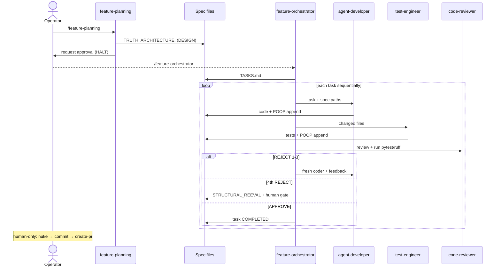

# Dmitri document-driven pipeline

Adapted from the Peirce `harness-template` for this single-repo Python/Textual project. This is
the team's source of truth for how features move from idea to merged code.

## Profile

| Item | Value |
|------|-------|
| Project | Dmitri (network vulnerability scanner) |
| Config root | `.claude/` |
| Specs | `specs/NNN-feature-slug/` (flat docs) |
| Knowledge base | `docs/` (routing index: `docs/README.md`) |
| App source | `hardware-agent/src/agent/` |
| Test command | `uv run pytest` (cwd `hardware-agent/`) |
| Lint command | `uv run ruff check` |
| Build | n/a (Python) — reviewer gates on pytest + ruff |
| Nuke base branch | `main` |
| Layers | single layer — one coder, `INTEGRATION.md` usually omitted |

## Roles

| Role | Who | Does |
|------|-----|------|
| Operator | Human | Invokes skills, approves specs, accepts dev-ready work |
| Planner | `feature-planning` skill | Phase 1 — writes specs, stops for approval |
| Refiner | `refine-specs` skill | Phase 1.5 — grills specs, edits them inline |
| Orchestrator | `feature-orchestrator` skill | Phases 2–5 — TASKS.md, spawns subagents, never edits app code |
| Subagents | `architecture-agent`, `tui-design-agent`, `agent-developer`, `test-engineer`, `code-reviewer` | Plan, implement, test, approve/reject |
| Nuke | Human only — `nuke` skill | Pre-push branch-delta audit; report only |
| Commit / PR | Human only — `commit`, `create-pr` skills | Local commits, then open the PR |

## Phases

```
0. (optional) consult-docs to load the knowledge base selectively
1. /feature-planning            → TRUTH.md, ARCHITECTURE.md, (DESIGN.md)  → [HALT]
1.5 /refine-specs               → grill + edit specs inline (optional)
    --- human approves specs ---
2. /feature-orchestrator        → TASKS.md
3. per task (sequential): agent-developer → test-engineer → code-reviewer
   - [REJECT] 1–3 → fresh agent-developer with feedback
   - 4th [REJECT] → STRUCTURAL_REEVAL.md + human gate
   - [APPROVE]    → task COMPLETED
4. all tasks COMPLETED + tests green
   --- human-only tail ---
5. nuke   → SHIP | FIX BEFORE PUSH
6. commit → logical commits
7. create-pr → open the PR
```

Phases 5–7 are **human-only** and must never run inside the orchestrator.

## Spec documents

| File | Owner | Purpose |
|------|-------|---------|
| `TRUTH.md` | Planner | Domain narrative, business rules, verifiable acceptance criteria |
| `ARCHITECTURE.md` | architecture-agent | Pipeline fit, contracts, mandatory file/naming table, testing |
| `DESIGN.md` | tui-design-agent | Textual screen flow, bindings, copy, states, widget ids (UI only) |
| `INTEGRATION.md` | architecture-agent | Cross-layer contract (rare) |
| `TASKS.md` | Orchestrator | Execution checklist + status |
| `POOP.md` | Subagents | Append-only execution ledger |
| `STRUCTURAL_REEVAL.md` | Orchestrator | Plan revision after a 4th rejection |

Canonical shapes live in `specs/_templates/`.

## Sequence



## Anti-patterns

| Anti-pattern | Correct behavior |
|--------------|------------------|
| Orchestrator "just fixes" one file | Spawn a fresh coder with the `[REJECT]` feedback |
| Pasting full specs into every spawn | Pass file paths only |
| Parallel coders on different tasks | Sequential tasks |
| Marking COMPLETED after the coder says done | Require a `[APPROVE]` from the reviewer |
| Resuming the same coder after a reject | Always a new coder |
| Ignoring the 4th rejection | Structural re-eval + human gate |
| New runner param not threaded through TUI | Honor the CLAUDE.md integration rule |
| Orchestrator runs nuke / commit / PR | Human-only, after the pipeline |

## Relationship to existing skills

- `create-tasks` (harness TaskCreate-based) is left in place; the orchestrator's `TASKS.md`
  markdown file is the pipeline's source of truth for execution.
- `tdd`, `code-review`, `verify`, `diagnose` remain available as standalone tools; the
  `code-reviewer` subagent is the in-loop gate.
- `commit` and `create-pr` cover the human-only release tail (Phases 6–7).
- The 5 pre-existing folder-tree specs (`000`–`004`) are not migrated.
