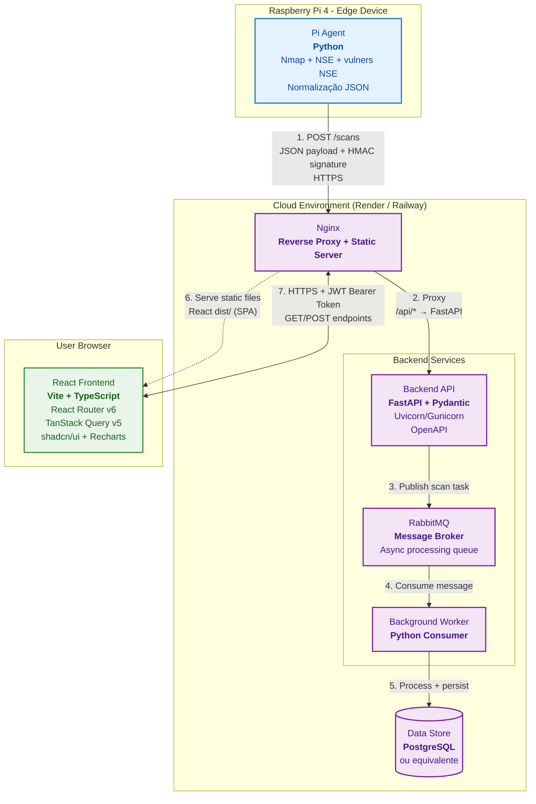

# System Architecture Document

## 1. Objective

Este documento consolida todas as decisões de arquitetura tomadas nos ADRs do Sprint 1.

## 2. System components and their responsibilities

### 2.1 Pi Agent
- **Onde roda:** Raspberry Pi 4 Model B 4 GB (headless)
- **Responsabilidades:**
  - Execução de varreduras externas de rede
  - Descoberta de hosts, portas, serviços e SO via Nmap
  - Execução de scripts NSE (`default`, `safe`, `vuln`, `auth`, `discovery`)
  - Correlação de vulnerabilidades via **vulners NSE**
  - Normalização dos resultados em payload JSON estruturado
  - Envio seguro do payload para o Backend API
- **Restrições:** 4 GB RAM, CPU ARM64, adaptador Wi-Fi USB dedicado para monitor mode

### 2.2 Backend API
- **Onde roda:** Cloud (Render ou Railway recomendado)
- **Tecnologia:** FastAPI (Python) + Pydantic
- **Responsabilidades:**
  - Recebimento e validação de payloads do Pi Agent
  - Persistência dos resultados de scans
  - Exposição de REST API para o Frontend
  - Aplicação das regras de autenticação e autorização
  - Geração automática de documentação OpenAPI

### 2.3 React Frontend
- **Onde roda:** Navegador do usuário (SPA)
- **Tecnologia:** React + TypeScript + Vite
- **Responsabilidades:**
  - Interface de visualização dos resultados de scans
  - Dashboard, lista de scans, detalhe de dispositivos, inventário de rede
  - Autenticação e gerenciamento de sessões
  - Consumo da API via TanStack Query

### 2.4 RabbitMQ (Message Broker)
- **Onde roda:** Cloud (mesmo ambiente do Backend API)
- **Tecnologia:** RabbitMQ
- **Responsabilidades:**
  - Receber tarefas de processamento de scans enviadas pelo Backend API
  - Desacoplar o recebimento do scan do seu processamento pesado
  - **Garantir entrega confiável das mensagens para os workers**
  - **Permitir processamento assíncrono e escalável dos resultados de varredura**

### 2.5 Background Worker
- **Onde roda:** Cloud (como consumer do RabbitMQ)
- **Tecnologia:** Python
- **Responsabilidades:**
  - Consumir mensagens da fila do RabbitMQ
  - Processar os resultados de scans (enriquecimento, correlações, cálculos de risco, etc.)
  - Persistir os dados processados no Data Store
  - Executar tarefas demoradas sem bloquear a API principal

### 2.6 Data Store
- **A definir** (recomendação comum: PostgreSQL)
- Responsável por armazenar scans, dispositivos, usuários e histórico

## 3. Component diagram showing data flow

## Fluxo principal

- Pi Agent realiza varredura → normaliza → envia via POST com HMAC  
- Backend valida, persiste e processa  
- Frontend React consulta via JWT e exibe os resultados  

---

### 4. Deployment Topology

De acordo com a decisão do ADR-007, esta é a definição de onde cada componente roda:

- **Raspberry Pi 4 Model B 4 GB**  
  - Roda apenas o **Pi Agent**.

- **Cloud (servidor na nuvem)**  
  - Roda:
      - **Backend API (FastAPI)**
      - **RabbitMQ (Message Broker)**
      - **Background Worker (consumer do RabbitMQ)**
      - **Data Store (Banco de dados)**
      - **Arquivos estáticos do React Frontend**

- **Navegador (Browser)**  
  - Roda o **React Frontend** (aplicação SPA).

### Recomendação de implantação

- O frontend React será servido como **arquivos estáticos**.  
- O Backend API será exposto via **proxy reverso** usando **Nginx + Docker**.
- O processamento pesado dos scans será feito de forma assíncrona via RabbitMQ + Background Worker.
- O Pi Agent envia os dados para o Backend na nuvem via **HTTPS**.

---

## 5. Technology Stack with Pinned Version Numbers from all ADRs

| Camada              | Componente / Ferramenta                          | Versão / Especificação                          | ADR de Referência | Observação |
|---------------------|--------------------------------------------------|-------------------------------------------------|-------------------|----------|
| **Hardware**        | Raspberry Pi 4 Model B                           | 4 GB RAM (Broadcom BCM2711)                     | ADR-001           | Plataforma padrão de produção |
| **Hardware**        | Adaptador Wi-Fi USB                              | ALFA AWUS036ACM (chipset MT7612U)               | ADR-001           | Suporte monitor mode via mac80211 |
| **Hardware**        | Armazenamento                                    | microSD 64 GB A2/V30                            | ADR-001           | Mínimo recomendado |
| **Sistema Operacional** | Raspberry Pi OS                               | Lite (headless)                                 | ADR-001 / ADR-002 | Versão mais recente estável (2026) |
| **Pi Agent**        | Linguagem                                        | Python 3.13+                                    | ADR-002 / ADR-006 | — |
| **Pi Agent**        | Ferramenta principal de varredura                | Nmap + NSE                                      | ADR-002           | Inclui categorias: `default`, `safe`, `vuln`, `auth`, `discovery` |
| **Pi Agent**        | Correlação de vulnerabilidades                   | vulners NSE                                     | ADR-002 / ADR-006 | — |
| **Pi Agent**        | Ferramentas v2 (condicionais)                    | enum4linux-ng, testssl.sh, Nikto                | ADR-002 / ADR-006 | Ativadas apenas quando portas específicas são detectadas |
| **Backend**         | Framework principal                              | **FastAPI (v. 0.135.2)**                                     | ADR-003           | Versão mais recente estável recomendada |
| **Backend**         | Validação de dados                               | **Pydantic** v2+                                | ADR-003           | — |
| **Backend**         | Servidor ASGI                                    | **Uvicorn (v. 0.30.0) / Gunicorn (v. 23.0.0)**                              | ADR-007           | Produção: Gunicorn + Uvicorn workers |
| **Backend**         | Proxy reverso + arquivos estáticos               | **Nginx**                                       | ADR-007           | Serve React `dist/` + proxy `/api/*` |
| **Backend**         | Message Broker                    | **RabbitMQ (v. 4.0.x)**                                     | N.A.           | Versão mais recente estável recomendada |
| **Backend**         | Background Worker                    | **Python Consumer**                                     | N.A.           | Versão mais recente estável recomendada |
| **Frontend**        | Framework                                        | **React (v. 19.2.4)** + **TypeScript (v. 5.9.0)**                      | ADR-008           | — |
| **Frontend**        | Build tool                                       | **Vite 8.0.3**                                        | ADR-008           | — |
| **Frontend**        | Roteamento                                       | **React Router** v6                             | ADR-008           | — |
| **Frontend**        | Gerenciamento de estado e cache                  | **TanStack Query** v5                           | ADR-008           | — |
| **Frontend**        | Biblioteca de componentes UI                     | **shadcn/ui**                                   | ADR-008           | Componentes copiados para o projeto |
| **Frontend**        | Gráficos                                         | **Recharts**                                    | ADR-008           | — |
| **Frontend**        | Cliente HTTP                                     | **Axios (v. 1.13.6)**                                           | ADR-008           | Instância centralizada em `/src/api/client.ts` |
| **Segurança**       | Autenticação Agent → Backend                     | **HMAC** (secret único por device)              | ADR-005           | Assinatura + timestamp + nonce |
| **Segurança**       | Autenticação Frontend → Backend                  | **JWT** (access + refresh token) + httpOnly cookies | ADR-005       | — |
| **Segurança**       | Transporte                                       | **HTTPS** obrigatório                           | ADR-005 / ADR-007 | Let’s Encrypt em produção |
| **Infraestrutura**  | Deploy                                           | **Docker + Docker Compose (v. 27.1+)**                        | ADR-007           | Multi-stage (Nginx + FastAPI) |
| **Infraestrutura**  | Hosting                                          | Cloud (Render ou Railway recomendado)           | ADR-007           | — |
| **Data Store**      | Banco de dados                                   | **A ser definido** (recomendado: PostgreSQL)   | —                 | Será formalizado no próximo ADR |

---

## 6. Component Interfaces

Todas as interfaces seguem o padrão REST + JSON. A documentação completa da API é gerada automaticamente pelo FastAPI (OpenAPI/Swagger).

### 6.1 Pi Agent → Backend API
- **Método**: `POST /scans`
- **Autenticação**: HMAC signature (secret único por dispositivo)
- **Payload**: JSON contendo:
  - Metadados do scan (timestamp, device_id, rede escaneada)
  - Resultados normalizados de Nmap + NSE + vulners NSE
  - Descobertas de hosts, portas, serviços, versões, SO e CVEs
- **Formato de autenticação**: Header customizado + assinatura do body (método + path + timestamp + body hash)
- **Resposta esperada**: `202 Accepted` com ID do scan registrado
- **Referência**: ADR-002, ADR-005, ADR-007

### 6.2 React Frontend → Backend API
- **Autenticação**: JWT Bearer Token (access token short-lived) + refresh token em httpOnly cookie
- **Métodos principais**:
  - `GET /scans` → Lista de scans realizados
  - `GET /scans/{scan_id}` → Detalhes de um scan específico
  - `GET /devices` → Inventário de dispositivos descobertos
  - `GET /devices/{device_id}` → Detalhes de um dispositivo
  - `POST /auth/login` → Login (email/senha ou SSO)
  - `POST /auth/register` → Registrar novo usuário
  - `PATCH /auth/new-password` → Redefinir senha
- **Formato**: JSON completo (request e response)
- **Contrato**: Tipos TypeScript gerados automaticamente via `openapi-typescript` a partir do schema OpenAPI do FastAPI
- **Referência**: ADR-003, ADR-005, ADR-008

### 6.3 Backend API → Background Worker (comunicação assíncrona)
- **Método de comunicação**: Publicação de mensagens via **RabbitMQ**
- **Padrão**: Producer/Consumer (fila de tarefas)
- **Conteúdo da mensagem**:
  - ID do scan recebido
  - Payload JSON completo do scan
  - Metadados de processamento (prioridade, timestamp, device_id)
- **Objetivo**: Desacoplar o recebimento do scan (rápido) do processamento pesado (enriquecimento, cálculos de risco, correlações, etc.)
- **Resposta**: Não há resposta síncrona (fire-and-forget). O Background Worker processa a mensagem de forma assíncrona.
- **Referência**: Arquitetura assíncrona (RabbitMQ)

### 6.4 Backend API → React Frontend
- **Respostas**: Sempre JSON estruturado
- **Documentação interativa**: Swagger UI (`/docs`) e ReDoc (`/redoc`) disponíveis em ambiente de desenvolvimento e produção
- **CORS**: Configurado para aceitar apenas as origens permitidas (domínio de produção + localhost em dev)

### 6.5 Resumo das Restrições de Interface
- Todas as comunicações externas ocorrem sobre **HTTPS**
- O Pi Agent utiliza apenas comunicação **one-way** (push) via HMAC
- O React Frontend nunca acessa diretamente o Pi Agent
- Nenhum componente expõe endpoints sem autenticação em produção
- A comunicação interna entre Backend API e Background Worker é feita exclusivamente via **RabbitMQ** (assíncrona e desacoplada)

---

## 7. Assumptions e Constraints

- Orçamento máximo por unidade de hardware: R$ 1.250  
- Hardware padrão: Raspberry Pi 4 4 GB (Pi 5 descartado por custo)  
- Timeline total do projeto: 12 semanas  
- Time pequeno → simplicidade e manutenibilidade são prioridades  
- Operação do scanner: externa e majoritariamente passiva (v1)  
- Rede: Assume conectividade de saída para o Backend (HTTPS)  
- Dados sensíveis: Portas, serviços, vulnerabilidades e CVEs  

---

## 8. CORS Configuration

### Configuração de CORS do Backend FastAPI

O backend FastAPI deve ser configurado para aceitar requisições apenas de origens confiáveis, conforme definido nos ADRs de segurança (**ADR-005**) e deployment (**ADR-007**).  
Isso protege a API contra acessos não autorizados vindos de outros sites.

### Produção (Cloud)

Na produção, o backend aceitará requisições somente do domínio oficial do frontend:

**Origens permitidas:**

- `https://app.dominio.com` (domínio principal do dashboard)

**Motivo:**

- Reduz significativamente o risco de ataques via navegador, como XSS ou requisições maliciosas de outros sites.
- Habilitar `allow_credentials = True` é necessário porque a autenticação do frontend utiliza JWT com cookies `httpOnly`. Sem essa configuração, o navegador bloquearia o envio automático dos cookies de autenticação.

### Desenvolvimento (Local)

Durante o desenvolvimento, o backend aceitará requisições vindas das portas normalmente usadas pelo Vite:

- `http://localhost:5173`  
- `http://localhost:3000`

**Motivo:**

- Facilita o trabalho do time, permitindo rodar frontend e backend em máquinas locais sem problemas de CORS.

### Considerações Gerais

- Em produção, **não será usado wildcard (`*`)** para origens, pois isso é incompatível com `allow_credentials = True` e reduziria a segurança.
- A configuração precisa permitir alguns headers customizados usados pelo Pi Agent (como os relacionados à assinatura HMAC), mas isso será tratado na implementação.
- Qualquer alteração na lista de origens permitidas deve ser revisada para evitar expor a API desnecessariamente.

Essa configuração garante o equilíbrio entre **segurança** (em produção) e **praticidade** (no desenvolvimento), alinhada com as decisões de autenticação JWT e HMAC definidas nos ADRs 005 e 007.

---
