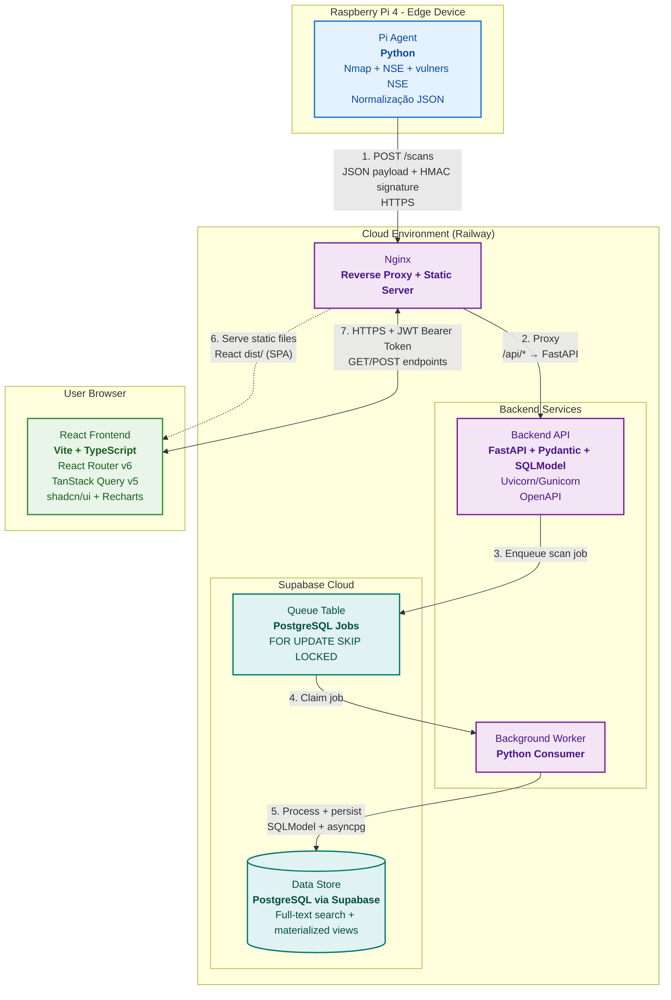

# DMITRI: UMA ABORDAGEM EMBARCADA PARA SEGURANÇA E ANÁLISE DE VULNERABILIDADES EM REDES

## Resumo

Este trabalho apresenta a proposta e o desenvolvimento do DMITRI, uma plataforma de varredura de vulnerabilidades para redes locais baseada em dispositivo embarcado. A solução combina um agente executado em Raspberry Pi 4, responsável pela descoberta de hosts, enumeração de portas, identificação de serviços e correlação inicial de vulnerabilidades por meio do Nmap e de scripts NSE, com uma plataforma web composta por backend, banco de dados e interface de visualização. Metodologicamente, trata-se de uma pesquisa aplicada, de caráter exploratório e experimental, fundamentada em revisão bibliográfica, definição arquitetural orientada por componentes e implementação incremental. Na etapa atual do projeto, já se encontram definidos e parcialmente implementados o pipeline principal de varredura, a normalização dos resultados em formato estruturado e a persistência centralizada dos achados. Para a etapa final do trabalho, prevê-se a incorporação de uma camada de inteligência de vulnerabilidades com enriquecimento por CVE, NVD, CISA KEV e EPSS, além de um mecanismo assistivo baseado em modelo de linguagem para sumarização técnica e apoio à triagem. Espera-se, como resultado, uma solução de baixo custo, rastreável e adequada ao contexto acadêmico, capaz de ampliar a visibilidade sobre a superfície de ataque de redes locais e apoiar a priorização de remediação.

**Palavras-chave:** varredura de vulnerabilidades. Raspberry Pi. Nmap. inteligência de vulnerabilidades. segurança de redes.

## Abstract

This work presents the proposal and development of DMITRI, an embedded-device-based vulnerability scanning platform for local networks. The solution combines an agent running on a Raspberry Pi 4, responsible for host discovery, port enumeration, service identification, and initial vulnerability correlation through Nmap and NSE scripts, with a web platform composed of backend, database, and visualization interface. Methodologically, this is an applied research project with exploratory and experimental characteristics, grounded in literature review, component-oriented architectural design, and incremental implementation. At the current stage of the project, the main scanning pipeline, structured result normalization, and centralized persistence of findings have already been defined and partially implemented. For the final stage of the work, the project is expected to incorporate a vulnerability intelligence layer enriched with CVE, NVD, CISA KEV, and EPSS data, as well as an LLM-based assistive mechanism for technical summarization and triage support. The expected outcome is a low-cost, traceable solution suitable for the academic context, capable of improving visibility into the attack surface of local networks and supporting remediation prioritization.

**Keywords:** vulnerability scanning. Raspberry Pi. Nmap. vulnerability intelligence. network security.

## 1. Introdução

A ampliação contínua da superfície de ataque em redes locais e corporativas torna a identificação de ativos expostos e vulnerabilidades conhecidas uma atividade central para a segurança da informação. Nesse contexto, ferramentas de descoberta e auditoria de rede assumem papel relevante ao permitir que administradores e pesquisadores observem hosts ativos, serviços publicados, versões de software e indícios de falhas associadas a esses serviços (LYON, 2009). Ao mesmo tempo, a mera enumeração técnica dos achados já não é suficiente para apoiar decisões de remediação, dado o volume crescente de vulnerabilidades publicadas e a desigual probabilidade de exploração entre elas (JACOBS et al., 2021).

Em paralelo, mecanismos padronizados de identificação e catalogação, como o Common Vulnerabilities and Exposures (CVE), e bases estruturadas como o National Vulnerability Database (NVD), tornaram-se centrais para a interoperabilidade entre ferramentas, relatórios e fluxos de gerenciamento de vulnerabilidades (CVE PROGRAM, [s.d.]; NATIONAL INSTITUTE OF STANDARDS AND TECHNOLOGY, [s.d.]). Mais recentemente, abordagens de priorização orientadas por evidências, como o Known Exploited Vulnerabilities Catalog (KEV), mantido pela CISA, e o Exploit Prediction Scoring System (EPSS), proposto pela FIRST, passaram a complementar métricas tradicionais de severidade ao incorporar informações sobre exploração observada e probabilidade de abuso em curto prazo (CYBERSECURITY AND INFRASTRUCTURE SECURITY AGENCY, [s.d.]; FIRST, [s.d.]).

É nesse cenário que se insere este trabalho. Propõe-se o desenvolvimento do DMITRI, uma plataforma de varredura de vulnerabilidades para redes locais baseada em um dispositivo embarcado de baixo custo, com foco em rastreabilidade, modularidade e viabilidade acadêmica. Em vez de se restringir à execução pontual de scans, a proposta busca integrar descoberta de ativos, normalização de resultados, persistência estruturada, enriquecimento contextual dos achados e apoio à interpretação técnica. Com isso, o projeto evolui de um scanner de rede tradicional para uma plataforma voltada à organização e análise de vulnerabilidades.

### 1.1 Objetivos

**Objetivo geral**

Desenvolver uma plataforma de varredura de vulnerabilidades para redes locais, baseada em dispositivo embarcado, capaz de identificar ativos expostos, correlacionar vulnerabilidades conhecidas, armazenar os resultados de forma estruturada e apoiar a análise e a priorização de remediação.

**Objetivos específicos**

- Implementar um agente de varredura em Raspberry Pi 4 para descoberta de hosts, enumeração de portas, detecção de serviços e coleta de evidências com Nmap e NSE.
- Definir um pipeline de normalização de resultados em formato JSON, padronizando dispositivos, portas, serviços, artefatos e findings.
- Construir um backend com API REST para recebimento, validação, persistência e consulta dos resultados de varredura.
- Modelar um banco de dados relacional para manter histórico de scans, inventário de dispositivos, serviços observados e vulnerabilidades correlacionadas.
- Disponibilizar uma interface web para consulta de scans, dispositivos, findings e indicadores de risco.
- Evoluir a solução para uma camada de inteligência de vulnerabilidades com enriquecimento por CVE, NVD, KEV e EPSS.
- Investigar o uso assistivo de modelos de linguagem para sumarização técnica, explicação de evidências e apoio à triagem, preservando rastreabilidade e controle de escopo.
- Validar a solução em ambiente controlado, observando a qualidade dos achados produzidos e a adequação do desempenho do hardware embarcado ao cenário de uso proposto.

### 1.2 Justificativa

A relevância do tema decorre de um problema prático recorrente: redes locais de pequeno e médio porte frequentemente apresentam serviços expostos, ativos desatualizados e lacunas de inventário, mas nem sempre dispõem de soluções de monitoramento contínuo compatíveis com suas restrições de custo, transparência e facilidade de operação. Em ambientes acadêmicos, laboratoriais e em pequenas e médias empresas, essa limitação é ainda mais sensível, pois a adoção de plataformas fechadas ou de alto custo reduz tanto a acessibilidade quanto a possibilidade de compreender tecnicamente o funcionamento da solução empregada.

Além disso, a gestão moderna de vulnerabilidades exige mais do que uma classificação baseada apenas em severidade. Conforme argumentam Jacobs et al. (2021), a priorização de remediação depende de modelos que consigam distinguir vulnerabilidades que efetivamente apresentam maior probabilidade de exploração. Nesse mesmo sentido, a CISA mantém o KEV Catalog como fonte autoritativa de vulnerabilidades já exploradas em ambiente real e recomenda seu uso como insumo para frameworks de priorização (CYBERSECURITY AND INFRASTRUCTURE SECURITY AGENCY, [s.d.]).

Do ponto de vista acadêmico, o projeto também é justificável por articular quatro temas relevantes e atuais: segurança de redes, sistemas embarcados, engenharia de software orientada a serviços e uso responsável de inteligência artificial. Revisões recentes indicam que modelos de linguagem vêm sendo aplicados a tarefas de análise e suporte em cibersegurança, mas ainda apresentam limitações relacionadas à confiabilidade, à explicabilidade e ao controle do contexto utilizado (SILVA; WESTPHALL, 2024; XU et al., 2024). Dessa forma, o trabalho contribui não apenas com uma implementação prática, mas também com uma discussão metodológica sobre como combinar coleta de evidências, priorização orientada por dados e apoio assistivo sem comprometer auditabilidade. Também há uma contribuição social e econômica potencial, na medida em que uma solução de menor custo e maior simplicidade operacional pode ampliar o acesso a práticas básicas de visibilidade e gestão de risco em organizações que normalmente não possuem equipe especializada.

### 1.3 Definição do escopo, contextualização e oportunidades

O escopo do trabalho concentra-se na varredura de redes locais a partir de um dispositivo posicionado no ambiente-alvo, porém externo aos hosts analisados. Assim, a solução não pressupõe acesso shell aos ativos escaneados, nem execução de pós-exploração, movimentação lateral ou automação ofensiva irrestrita. Seu foco principal está na observação da superfície de ataque exposta, na identificação de serviços ativos, no levantamento de vulnerabilidades conhecidas e na organização dos resultados em uma plataforma consultável e historizável.

Na implementação base, o sistema é estruturado em três frentes complementares. A primeira é a coleta técnica, realizada pelo agente embarcado com perfis de varredura configuráveis. A segunda é a consolidação dos dados, efetuada pelo backend e pela camada de persistência relacional. A terceira é a visualização e análise dos achados, a ser concluída com a interface web e com mecanismos de priorização de risco. Esse recorte torna o projeto viável para o contexto do TCC, preservando complexidade suficiente para demonstrar integração entre hardware, software e segurança de redes.

Embora o trabalho não tenha como foco exclusivo dispositivos de Internet das Coisas, esse domínio aparece como aplicação complementar relevante. Em redes locais contemporâneas, câmeras, impressoras, sensores, roteadores e outros dispositivos embarcados compartilham a mesma superfície de exposição observável pelo sistema e, portanto, podem ser contemplados pelo processo de descoberta, enumeração e análise. Dessa forma, o projeto não se limita a estações de trabalho ou servidores convencionais, mas também dialoga com cenários híbridos em que ativos tradicionais e dispositivos IoT coexistem.

No entanto, o trabalho não se limita ao estado atual da implementação. Considerando a entrega final prevista, a principal oportunidade de evolução está na transição de um scanner de rede para uma plataforma de inteligência de vulnerabilidades. Isso implica ir além da identificação de CVEs e incorporar fontes complementares de contexto e priorização. O CVE fornece um identificador comum para vulnerabilidades; o NVD agrega metadados estruturados e métricas padronizadas; o KEV destaca vulnerabilidades com exploração observada; e o EPSS estima a probabilidade de exploração em curto prazo (CVE PROGRAM, [s.d.]; NATIONAL INSTITUTE OF STANDARDS AND TECHNOLOGY, [s.d.]; CYBERSECURITY AND INFRASTRUCTURE SECURITY AGENCY, [s.d.]; FIRST, [s.d.]).

Outra oportunidade relevante reside no uso assistivo de modelos de linguagem. Em vez de atribuir autonomia operacional ao modelo, a proposta é utilizá-lo como mecanismo de apoio à interpretação, sumarização e organização dos achados persistidos. Essa abordagem é coerente com estudos recentes sobre o uso de modelos de linguagem em cibersegurança, que destaca potencial em tarefas analíticas, quanto a diretrizes de uso responsável que enfatizam governança, rastreabilidade e gestão de risco em sistemas de IA (SILVA; WESTPHALL, 2024; XU et al., 2024; NATIONAL INSTITUTE OF STANDARDS AND TECHNOLOGY, 2025).

### 1.4 Métodos e Tecnologias

Este trabalho caracteriza-se como uma pesquisa aplicada, de natureza tecnológica, com elementos exploratórios e experimentais. É aplicada porque busca construir uma solução funcional para um problema concreto de segurança de redes. É exploratória porque investiga a composição de uma arquitetura leve e evolutiva para descoberta e priorização de vulnerabilidades. E é experimental porque depende da implementação, integração e avaliação de um pipeline real de coleta e processamento.

A abordagem metodológica combina revisão bibliográfica, definição arquitetural orientada por decisões documentadas, prototipação incremental e validação por cenários de uso. Em um primeiro momento, são analisadas ferramentas e fundamentos de varredura de rede, mecanismos padronizados de identificação de vulnerabilidades e modelos de priorização baseados em contexto. Em seguida, é definida a arquitetura da solução e a responsabilidade de cada componente. Por fim, são implementados o agente embarcado, o backend, a persistência e os mecanismos de processamento e consulta, avaliando-se a capacidade do sistema de produzir achados estruturados, consistentes e consultáveis.

Como estratégia de avaliação, prevê-se a validação do sistema em ambiente controlado, com observação do comportamento do agente embarcado durante a execução das varreduras, do volume e consistência dos dados coletados, e da capacidade da arquitetura de persistir e apresentar tais resultados de maneira utilizável. Essa etapa é importante para verificar não apenas a correção funcional da solução, mas também sua adequação prática a um contexto de baixo custo e operação simplificada.

Do ponto de vista tecnológico, a plataforma utiliza Raspberry Pi 4 como base de hardware embarcado, Python como linguagem principal do agente e do backend, Nmap e Nmap Scripting Engine como núcleo do pipeline de varredura, FastAPI para a construção da API REST, SQLModel e PostgreSQL para modelagem e persistência, e React com TypeScript para a camada web. A escolha do Nmap se justifica por sua ampla adoção, cobertura funcional e adequação a tarefas de descoberta, enumeração e detecção de serviços em auditoria de rede (LYON, 2009). Já a incorporação planejada de NVD, KEV e EPSS busca alinhar a solução a práticas contemporâneas de gerenciamento de vulnerabilidades baseadas em interoperabilidade e priorização orientada por evidências (NATIONAL INSTITUTE OF STANDARDS AND TECHNOLOGY, [s.d.]; CYBERSECURITY AND INFRASTRUCTURE SECURITY AGENCY, [s.d.]; FIRST, [s.d.]).

## 2. Revisão Bibliográfica

### 2.1 Varredura de redes e descoberta de serviços

A descoberta de ativos, a enumeração de portas e a identificação de serviços constituem a base técnica de plataformas de avaliação de exposição em rede. Lyon (2009) descreve o Nmap como uma ferramenta de exploração e auditoria de rede capaz de determinar quais hosts estão ativos, quais serviços e versões estão sendo oferecidos e quais características adicionais podem ser inferidas a partir do comportamento de resposta dos alvos. Essa abordagem por múltiplas fases é particularmente relevante para o presente trabalho, pois permite modularidade, adaptação de perfis de varredura e controle sobre custo computacional, aspectos importantes em dispositivos embarcados.

A literatura técnica também evidencia que a qualidade da detecção de serviços é decisiva para etapas posteriores de correlação de vulnerabilidades. A identificação incorreta ou incompleta de produto e versão pode comprometer tanto o mapeamento para CVEs quanto a qualidade das recomendações de remediação. Por isso, a separação entre descoberta de hosts, enumeração de portas, detecção de serviços e execução seletiva de scripts representa uma estratégia coerente com o estado da prática descrito na documentação oficial do Nmap (LYON, 2009).

### 2.2 Identificação padronizada de vulnerabilidades

Para que os achados de segurança sejam interoperáveis entre ferramentas e compreensíveis por diferentes atores, é necessário adotar mecanismos padronizados de identificação. O CVE Program tem como propósito principal identificar unicamente vulnerabilidades e associá-las a versões específicas de bases de código, permitindo que diferentes organizações se refiram ao mesmo problema por um identificador comum (CVE PROGRAM, [s.d.]). Essa padronização é essencial em arquiteturas que pretendem armazenar, reprocessar e correlacionar achados ao longo do tempo.

O NVD complementa esse papel ao atuar como repositório governamental de dados padronizados de gerenciamento de vulnerabilidades, incluindo falhas de software, nomes de produtos e métricas de impacto, em formato adequado à automação (NATIONAL INSTITUTE OF STANDARDS AND TECHNOLOGY, [s.d.]). Em conjunto, CVE e NVD fornecem um eixo de normalização que favorece persistência estruturada, consulta histórica e integração com mecanismos de enriquecimento.

### 2.3 Priorização de vulnerabilidades e contexto de exploração

Um dos principais desafios do gerenciamento de vulnerabilidades está em distinguir falhas teoricamente severas daquelas que, na prática, demandam maior urgência de remediação. Jacobs et al. (2021) observam que estratégias tradicionais baseadas apenas em severidade frequentemente são insuficientes para priorizar de modo eficaz, especialmente em cenários com grande volume de CVEs. Como resposta a essa limitação, o EPSS propõe um modelo orientado por dados para estimar a probabilidade de exploração de uma vulnerabilidade, atualmente em janelas de curto prazo, e publica seus resultados em formato acessível para integração com fluxos de defesa (FIRST, [s.d.]).

De forma complementar, a CISA mantém o Known Exploited Vulnerabilities Catalog como fonte autoritativa de vulnerabilidades exploradas em ambiente real e recomenda seu uso como entrada em processos de priorização (CYBERSECURITY AND INFRASTRUCTURE SECURITY AGENCY, [s.d.]). A combinação entre um identificador comum, metadados estruturados, evidências de exploração observada e estimativas probabilísticas cria uma base conceitual robusta para a evolução deste projeto, permitindo construir um score de risco mais informativo do que o uso isolado de severidade.

### 2.4 Modelos de linguagem aplicados à cibersegurança

Revisões recentes indicam que modelos de linguagem têm sido aplicados a um conjunto crescente de tarefas em cibersegurança, incluindo detecção de vulnerabilidades, análise de malware, triagem de eventos e suporte à tomada de decisão (SILVA; WESTPHALL, 2024; XU et al., 2024). Ainda assim, os autores apontam limitações importantes relacionadas à confiabilidade das respostas, à possibilidade de alucinações e à necessidade de contexto técnico estruturado para reduzir ambiguidades.

Nesse sentido, o presente trabalho adota uma posição deliberadamente conservadora: o modelo de linguagem não é tratado como executor autônomo de ações na rede, mas como um componente assistivo para sumarização, explicação e priorização dos dados já persistidos pela plataforma. Essa opção converge com as diretrizes do NIST AI RMF, que destacam a importância de incorporar governança e gestão de risco ao desenvolvimento e uso responsável de sistemas de IA (NATIONAL INSTITUTE OF STANDARDS AND TECHNOLOGY, 2025).

### 2.5 Trabalhos Relacionados

Diversas soluções comerciais, open-source e acadêmicas foram desenvolvidas para realizar varredura e gerenciamento de vulnerabilidades. Elas podem ser agrupadas em duas categorias principais: ferramentas profissionais/enterprise e soluções mais leves ou voltadas para ambientes de baixo custo.

No segmento profissional, destacam-se o Nessus (Tenable) e o OpenVAS/Greenbone. O Nessus é um dos scanners mais consolidados do mercado, oferecendo detecção abrangente, relatórios avançados e suporte a autenticação. Seu preço para a versão Nessus Professional gira em torno de US$ 4.790 por ano por scanner (com scanning ilimitado de IPs), enquanto a versão Nessus Expert custa aproximadamente US$ 6.790 por ano (TENABLE, 2026). Já o OpenVAS, mantido pela Greenbone, oferece uma solução enterprise-grade open-source com suporte pago. A assinatura OpenVAS Basic custa cerca de € 2.524 por ano, representando uma opção mais acessível dentro do segmento profissional (GREENBONE NETWORKS, 2026).

Embora robustas e ricas em funcionalidades, essas soluções apresentam limitações significativas para o contexto deste trabalho: alto custo de aquisição e manutenção, exigência de recursos computacionais elevados e interfaces complexas, o que as torna pouco viáveis para pequenas empresas, ambientes residenciais e usuários com conhecimento técnico limitado.

No âmbito de soluções open-source leves e executáveis em hardware de baixo custo, o Vuls se destaca. Desenvolvido pela Future Architect, o Vuls é um scanner agentless focado em vulnerabilidades de pacotes e dependências em sistemas Linux (incluindo Raspbian), com integração a múltiplas fontes de inteligência (NVD, CISA KEV, Exploit Database etc.). Ele suporta execução em Raspberry Pi e geração de relatórios periódicos, sendo uma excelente opção para administradores de sistemas com restrições de custo (FUTURE ARCHITECT, 2025). No entanto, seu foco principal está na análise de pacotes instalados via SSH ou modo local, com menor ênfase em descoberta ativa de rede, enumeração detalhada de serviços e correlação em tempo real de dispositivos não gerenciados.

Estudos acadêmicos e técnicos também reforçam a viabilidade do uso de Raspberry Pi em segurança. Sainz-Raso et al. (2019) analisam as fraquezas de segurança nativas do Raspberry Pi, enquanto outros trabalhos exploram sua aplicação prática em cenários de pentest e auditoria IoT. No contexto deste trabalho, tais limitações foram consideradas desde o início do projeto. O DMITRI adota configurações headless, hardening do sistema operacional, autenticação forte via HMAC para o agente e execução mínima de serviços, visando minimizar a superfície de ataque do próprio dispositivo de varredura.

Nesse contexto, o DMITRI busca combinar características de scanners tradicionais com mecanismos adicionais de contextualização e priorização. Diferentemente das ferramentas enterprise (Nessus e Greenbone), o projeto prioriza baixo custo, facilidade de uso e usabilidade para pequenos negócios e usuários residenciais. Em relação ao Vuls, o DMITRI avança ao combinar descoberta ativa de rede via Nmap + NSE, normalização estruturada dos resultados, persistência histórica completa, enriquecimento com KEV/EPSS e um copiloto baseado em LLM para interpretação e triagem dos achados, características que transformam dados brutos em inteligência acionável de forma mais integrada.

## 3. Desenvolvimento

O desenvolvimento da solução foi organizado como um pipeline distribuído e incremental, no qual cada componente assume responsabilidades específicas na coleta, no tratamento, no armazenamento e na interpretação dos dados de segurança. A arquitetura proposta parte de um agente embarcado executado em Raspberry Pi 4, conectado à rede local, e integra esse agente a uma plataforma web composta por backend, banco PostgreSQL, worker de processamento e interface de visualização.

### 3.1 Arquitetura geral da solução

A arquitetura do DMITRI foi projetada com base nos princípios de separação de responsabilidades, escalabilidade e evolutividade. O sistema adota uma abordagem híbrida, combinando um agente embarcado de baixo custo para coleta de dados diretamente na rede local com uma plataforma backend em nuvem para processamento, armazenamento e visualização das informações.

O sistema é composto por cinco componentes principais:

- **Hardware Agent** — executado em Raspberry Pi 4;
- **Backend API** — responsável pelo recebimento e orquestração;
- **Background Worker** — processamento assíncrono de enriquecimento;
- **Banco de Dados** — PostgreSQL para persistência centralizada;
- **Frontend Web** — interface de visualização e interação.

Essa divisão modular permite que cada parte do sistema opere de forma otimizada, reduzindo o acoplamento entre os componentes e facilitando a manutenção e a evolução incremental do projeto.

Figura 1 – Arquitetura geral da solução

Fonte: Elaborado pelo autor (2026).

#### Descrição do fluxo principal

1. O **Hardware Agent**, executando no Raspberry Pi 4, realiza as varreduras na rede local utilizando Nmap e scripts NSE, normaliza os resultados em formato JSON estruturado e os envia de forma segura para o Backend.

2. O **Backend API** recebe o payload, realiza validações e enfileira a tarefa de processamento.

3. O **Background Worker** consome os jobs da fila, executa o enriquecimento dos achados (correlação de vulnerabilidades, cálculo de risco, etc.) e persiste os dados no banco.

4. O **Frontend Web** consome a API para exibir dashboards, histórico de scans, inventário de dispositivos, findings e recomendações de priorização.

Essa arquitetura oferece vantagens significativas: permite a execução eficiente em hardware com recursos limitados, mantém o processamento pesado fora do dispositivo embarcado, garante histórico completo e auditável dos scans, e separa claramente as etapas de coleta, enriquecimento e apresentação. Tal organização não apenas atende aos requisitos técnicos e de custo do projeto, como também favorece a auditabilidade e a reprodutibilidade dos resultados no contexto acadêmico.

### 3.2 Pipeline de varredura no agente embarcado

O agente embarcado implementa um pipeline de múltiplos estágios inspirado nas fases clássicas de varredura descritas por Lyon (2009). Inicialmente, realiza-se a descoberta de hosts ativos no alvo configurado. Em seguida, executa-se a enumeração de portas abertas conforme o perfil selecionado. Na terceira etapa, procede-se à detecção de serviços e versões nas portas observadas. Por fim, scripts NSE e mecanismos de correlação transformam evidências técnicas em achados estruturados.

Esse fluxo foi escolhido por equilibrar cobertura funcional e uso eficiente de recursos. Em um Raspberry Pi 4, uma abordagem monolítica e agressiva sobre todos os alvos e portas poderia comprometer tempo de execução, consumo de memória e utilidade prática do sistema. Já a segmentação por estágios permite escalonar profundidade conforme o perfil de scan, preservando a viabilidade operacional da solução.

Ao final da execução, o agente produz um payload JSON contendo metadados do scan, inventário de dispositivos, portas observadas, serviços identificados, artefatos gerados e findings correlacionados. Esse payload é persistido localmente e pode ser submetido ao backend por HTTPS, o que permite tanto rastreabilidade quanto reprocessamento posterior sem necessidade imediata de repetir a coleta.

### 3.3 Backend, persistência e processamento assíncrono

O backend foi projetado em FastAPI, expondo endpoints para ingestão e consulta dos resultados. Os dados recebidos são validados por schemas tipados e persistidos em PostgreSQL, com modelagem orientada a entidades como scan, device, port, service, finding, artifact e job de enriquecimento. Essa estrutura favorece consultas históricas, detalhamento por ativo e reconstrução do contexto de cada execução.

Uma decisão importante de implementação é a separação entre ingestão e enriquecimento. Em vez de concentrar toda a lógica analítica na mesma transação de recebimento do scan, o sistema utiliza uma fila baseada no próprio PostgreSQL para registrar jobs pendentes e delegar seu processamento a um worker dedicado. Essa estratégia reduz dependências externas, preserva simplicidade arquitetural e mantém aderência ao porte do projeto, sem abrir mão de extensibilidade.

### 3.4 Evolução prevista para inteligência de vulnerabilidades

Embora o pipeline base já produza findings correlacionados, a etapa final do projeto prevê uma camada adicional de inteligência de vulnerabilidades. Nessa fase, os achados deverão ser enriquecidos com fontes externas de priorização, especialmente NVD, KEV e EPSS. O papel de cada fonte é complementar: o CVE atua como identificador comum; o NVD fornece metadados estruturados e métricas; o KEV informa exploração observada; e o EPSS acrescenta uma estimativa probabilística de exploração (NATIONAL INSTITUTE OF STANDARDS AND TECHNOLOGY, [s.d.]; CYBERSECURITY AND INFRASTRUCTURE SECURITY AGENCY, [s.d.]; FIRST, [s.d.]).

Na prática, essa evolução deve resultar em novas estruturas de dados para referências externas, registros de priorização, snapshots de risco e histórico analítico por finding. Com isso, o backend poderá oferecer consultas mais especializadas, como resumos de risco por scan, detalhamento de evidências e linhas do tempo por dispositivo, ampliando a utilidade da plataforma para triagem e acompanhamento.

### 3.5 Camada de análise assistida por modelo de linguagem

Como etapa avançada do desenvolvimento, a solução prevê a incorporação de um componente assistivo baseado em modelo de linguagem. Seu papel não será executar ações autônomas sobre os alvos, mas sintetizar resultados, explicar por que um finding merece atenção, sugerir prioridades de remediação e apontar lacunas de evidência. Essa decisão está alinhada com a literatura recente, que reconhece o potencial dos LLMs em tarefas analíticas, mas também ressalta riscos de confiabilidade quando tais modelos atuam sem contexto estruturado ou sem mecanismos adequados de controle (SILVA; WESTPHALL, 2024; XU et al., 2024).

Para mitigar esses riscos, a proposta arquitetural prevê que toda interação do modelo ocorra sobre dados persistidos e por meio de ferramentas controladas pelo backend. Além disso, sessões, mensagens e chamadas de ferramentas devem ser armazenadas para auditoria. Tal desenho aproxima a solução das recomendações de uso responsável de IA, nas quais governança, rastreabilidade e gestão de risco são elementos centrais (NATIONAL INSTITUTE OF STANDARDS AND TECHNOLOGY, 2025).

### 3.6 Considerações de implementação

Do ponto de vista de requisitos não funcionais, o projeto prioriza baixo custo, modularidade, manutenibilidade e rastreabilidade. O uso de Raspberry Pi 4 atende à necessidade de uma plataforma embarcada acessível. A separação entre agente, backend e worker favorece evolução incremental e isolamento de responsabilidades. O emprego de contratos estruturados entre os componentes reduz inconsistências semânticas entre coleta, persistência e consulta. Já a centralização dos dados em PostgreSQL cria base adequada para histórico, auditoria e expansão futura.

Desse modo, o desenvolvimento proposto permite que a solução deixe de ser apenas uma integração entre scanner e painel web e se constitua como uma plataforma acadêmica de inteligência de vulnerabilidades. Parte-se de um núcleo viável de descoberta, enumeração e persistência e projeta-se sua evolução para enriquecimento contextual e suporte assistivo à análise, sem perder controle de escopo nem clareza metodológica.

## Referências

CYBERSECURITY AND INFRASTRUCTURE SECURITY AGENCY. Known Exploited Vulnerabilities Catalog. [S. l.], [s.d.]. Disponível em: <https://www.cisa.gov/known-exploited-vulnerabilities-catalog>. Acesso em: 12 maio 2026.

CVE PROGRAM. Common Vulnerabilities and Exposures (CVE). [S. l.], [s.d.]. Disponível em: <https://www.cve.org/about/overview>. Acesso em: 12 maio 2026.

FIRST. Exploit Prediction Scoring System (EPSS). [S. l.], [s.d.]. Disponível em: <https://www.first.org/epss/>. Acesso em: 12 maio 2026.

JACOBS, Jay; ROMANOSKY, Sasha; EDWARDS, Benjamin; ROYTMAN, Michael; ADJERID, Idris. Exploit Prediction Scoring System (EPSS). Digital Threats: Research and Practice, New York, v. 2, n. 3, 2021. Disponível em: <https://doi.org/10.1145/3436242>. Acesso em: 12 maio 2026.

LYON, Gordon. Nmap Network Scanning: the official Nmap Project guide to network discovery and security scanning. [S. l.]: Insecure.Com LLC, 2009.

NATIONAL INSTITUTE OF STANDARDS AND TECHNOLOGY. National Vulnerability Database. [S. l.], [s.d.]. Disponível em: <https://nvd.nist.gov/>. Acesso em: 12 maio 2026.

NATIONAL INSTITUTE OF STANDARDS AND TECHNOLOGY. NIST Artificial Intelligence Risk Management Framework (AI RMF). Gaithersburg, 2025. Disponível em: <https://www.nist.gov/document/about-nist-ai-rmf>. Acesso em: 12 maio 2026.

SILVA, Gabriel de Jesus Coelho da; WESTPHALL, Carlos Becker. A Survey of Large Language Models in Cybersecurity. arXiv, 2024. Disponível em: <https://doi.org/10.48550/arXiv.2402.16968>. Acesso em: 12 maio 2026.

XU, Hanxiang; WANG, Shenao; LI, Ningke; WANG, Kailong; ZHAO, Yanjie; CHEN, Kai; YU, Ting; LIU, Yang; WANG, Haoyu. Large Language Models for Cyber Security: A Systematic Literature Review. arXiv, 2024. Disponível em: <https://doi.org/10.48550/arXiv.2405.04760>. Acesso em: 12 maio 2026.

TENABLE. Nessus Vulnerability Scanner – Pricing. [S. l.], 2026. Disponível em: <https://www.tenable.com/buy>. Acesso em: 18 maio 2026.

GREENBONE NETWORKS. OpenVAS Basic – Pricing. [S. l.], 2026. Disponível em: <https://www.greenbone.net/en/openvas-basic-order/>. Acesso em: 18 maio 2026.

FUTURE ARCHITECT. Vuls: Agent-less vulnerability scanner. [S. l.], 2025. Disponível em: <https://github.com/future-architect/vuls>. Acesso em: 18 maio 2026.

SAINZ-RASO, Jorge et al. Security Vulnerabilities in Raspberry Pi – Analysis of the System Weaknesses. IEEE Consumer Electronics Magazine, v. 8, n. 6, p. 47-52, 2019.
