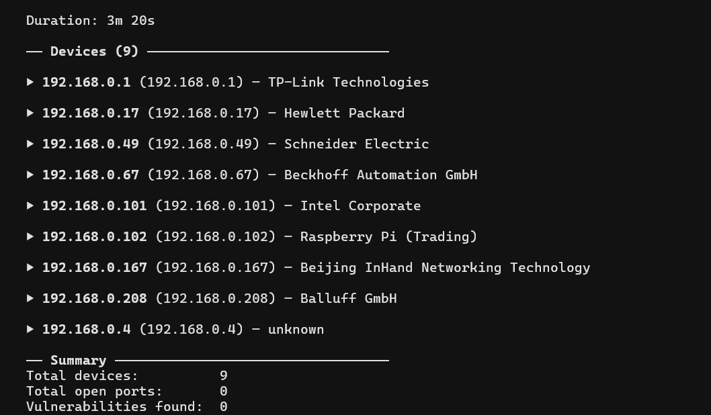

# NSPi September — field test results

> **Date:** 2026-07-03 · **Location:** NSPi lab · **Target:** `192.168.0.0/24` · **Operator setup:** dual-homed laptop (ethernet → NSPi, wifi → university internet)
>
> **Plan:** [`plan.md`](plan.md)

---

## Executive summary

| Question | Answer |
|----------|--------|
| Does dual-homing work? | **Yes** — nmap reaches NSPi devices; `vulners` returns CVEs over wifi |
| Does Dmitri Quick scan work on NSPi? | **Yes** — 9 devices, 52 findings, ~2m 37s |
| Does Dmitri NSPi mode work? | **No** — partial result, 0 ports, cancelled during port stage (~3m 20s) |
| Is this a routing problem? | **No** — same network, same session; Quick succeeded after NSPi attempt |
| Pilot approach | **Quick scan** on dual-homed laptop (field test closed; no retest) |

---

## Test matrix

| # | Tool / mode | When (local) | Duration | Devices | Open ports | CVEs | Outcome |
|---|-------------|--------------|----------|---------|------------|------|---------|
| 1 | `nmap` (no scripts) | 12:30 | — | 8 | Many | — | ✅ Baseline reachability |
| 2 | `nmap -sV --script vulners` | 12:41 | ~92s | 9 | Many | Yes | ✅ Manual vulners proof |
| 3 | Dmitri **NSPi** | 12:31 | 3m 20s | 9 | 0 | 0 | ⚠️ Partial — `user_cancel` during ports |
| 4 | Dmitri **Quick** | 12:34 | 2m 37s | 9 | Many | 52 | ✅ Complete |

---

## 1. Preflight — plain nmap (`nmap 192.168.0.0/24`)

Confirms layer-2 reachability and open ports without scripts.

| IP | Vendor | Open ports (sample) |
|----|--------|---------------------|
| 192.168.0.1 | TP-Link Technologies | 23/telnet, 80/http, 1900/upnp |
| 192.168.0.17 | Hewlett Packard | 80/http, 1217/hpss-ndapi |
| 192.168.0.49 | Schneider Electric | *(none in top 1000)* |
| 192.168.0.67 | Beckhoff Automation | 80, 139, 443, 445, 987, 5357, 8080 |
| 192.168.0.101 | Intel Corporate | 135, 139, 445, 3306/mysql, 7070 |
| 192.168.0.167 | Beijing InHand Networking | 21, 22, 53, 80, 222, 443, 9100 |
| 192.168.0.208 | Balluff GmbH | 22, 80, 139, 445 |
| 192.168.0.4 | *(no MAC)* | 135, 139, 445 |

*Note: plain nmap found 8 hosts; later scans found 9 (added 192.168.0.102 — Raspberry Pi).*

---

## 2. Manual vulners scan (`nmap -sV --script vulners 192.168.0.0/24`)

Proves `vulners.com` is reachable over wifi while scanning the NSPi subnet. Full output: `C:\Users\ronth\scan.txt`.

| IP | Service (version) | Sample CVEs |
|----|-------------------|-------------|
| 192.168.0.17 | lighttpd 1.4.58 | CVE-2022-41556, CVE-2022-30780, CVE-2022-22707 |
| 192.168.0.101 | MySQL 8.0.30 | CVE-2024-21057 |
| 192.168.0.102 | OpenSSH 10.0p2 | CVE-2026-35414, CVE-2026-35386, CVE-2026-35385 |
| 192.168.0.167 | OpenSSH 9.8 | CVE-2024-6387, CVE-2025-26465, … |
| 192.168.0.208 | OpenSSH 6.2 | CVE-2023-38408, CVE-2016-1908, CVE-2015-5600 |

Industrial devices present: Schneider Electric, Beckhoff, Balluff, InHand — typical ICS lab mix.

---

## 3. Dmitri NSPi mode — partial failure



| Field | Value |
|-------|-------|
| Scan ID | `543713be-f1cb-4374-94ec-7d34c5612252` |
| Saved result | `2026-07-03T15-31-40_192-168-0-0_24.json` |
| `partial_result` | `true` |
| `interrupted_stage` | `ports` |
| `terminated_by` | `user_cancel` |
| `elapsed_seconds` | 199.88 (~3m 20s) |

**Devices discovered (no ports attached):**

| IP | Vendor |
|----|--------|
| 192.168.0.1 | TP-Link Technologies |
| 192.168.0.17 | Hewlett Packard |
| 192.168.0.49 | Schneider Electric |
| 192.168.0.67 | Beckhoff Automation GmbH |
| 192.168.0.101 | Intel Corporate |
| 192.168.0.102 | Raspberry Pi (Trading) |
| 192.168.0.167 | Beijing InHand Networking Technology |
| 192.168.0.208 | Balluff GmbH |
| 192.168.0.4 | unknown |

**Interpretation:** discovery succeeded; port stage never populated results before cancel. No NSPi
port-stage nmap logs (`-T2 -n`) survived — likely pruned when the subsequent Quick scan wrote 10+
log folders. Operator reported the TUI became unresponsive; had to quit the application.

**Not validated:** whether `-n` caused the failure (no surviving port-stage logs). Leading hypothesis:
NSPi two-pass port stage is too slow / lacks progress feedback, not a routing issue.

---

## 4. Dmitri Quick mode — success

| Field | Value |
|-------|-------|
| Scan ID | `ee2be3d6-59fb-4045-8af6-4b927380e878` |
| Saved result | `2026-07-03T15-37-25_192-168-0-0_24.json` |
| `partial_result` | `false` |
| `terminated_by` | `completed` |
| `elapsed_seconds` | 157.13 (~2m 37s) |
| `findings_count` | 52 |

**Per-device summary:**

| IP | Vendor | Open ports | Notable services | CVE findings |
|----|--------|------------|------------------|--------------|
| 192.168.0.1 | TP-Link | 3 | http (TP-LINK WAP) | — |
| 192.168.0.17 | HP | 2 | lighttpd 1.4.58 | CVE-2022-41556, CVE-2022-30780, CVE-2022-22707 |
| 192.168.0.49 | Schneider | 0 | — | — |
| 192.168.0.67 | Beckhoff | 7 | ChipPC httpd, SMB, https | — |
| 192.168.0.101 | Intel | 5 | MySQL 8.0.30, SMB | CVE-2024-21057 |
| 192.168.0.102 | Raspberry Pi | 2 | OpenSSH 10.0p2 | CVE-2026-35414, CVE-2026-35386, … |
| 192.168.0.167 | InHand | 7 | OpenSSH 9.8, ftp, https | CVE-2024-6387, CVE-2025-26465, … |
| 192.168.0.208 | Balluff | 4 | OpenSSH 6.2, webdav | CVE-2023-38408, CVE-2016-1908, … |
| 192.168.0.4 | unknown | 3 | SMB | — |

---

## Artifacts

Dmitri workspace (Microsoft Store Python path on field laptop):

```
C:\Users\ronth\AppData\Local\Packages\PythonSoftwareFoundation.Python.3.13_qbz5n2kfra8p0\LocalCache\Local\Dmitri\results\
├── results\
│   ├── 2026-07-03T15-31-40_192-168-0-0_24.json   ← NSPi (partial)
│   └── 2026-07-03T15-37-25_192-168-0-0_24.json   ← Quick (complete)
└── logs\                                          ← Quick scan nmap runs only (NSPi logs pruned)
```

External reference: `C:\Users\ronth\scan.txt` (manual vulners run).

---

## Operator notes

- Dual-homed setup worked for the session.
- NSPi mode appeared stuck during port scanning; partial-scan UI may have crashed (unconfirmed — no crash dump).
- Quick scan immediately after proved the network and `vulners` path were fine.
- Backend `POST /scans` was not exercised.

---

## Decisions (move on — no retest planned)

Findings are sufficient to proceed. **No return visit to NSPi for validation** — next work is
roadmap delivery, not another field test.

| Decision | Basis |
|----------|-------|
| **Pilot SOP** | Dual-homed laptop + **Quick scan** on NSPi subnet |
| **Phase 1** | Closed — dual-homing and `vulners` validated |
| **NSPi scan mode** | Fix in dev ([`TASKS.md` T4.1](../../roadmap/TASKS.md)); not blocking roadmap |
| **Phase 2 offline ADR** | Deferred until unattended Pi or true air-gap customer |
| **Backend upload on-site** | Not tested; not gating current work |

Deferred (not scheduled):

- NSPi mode field re-validation
- Backend `POST /scans` over dual-homed wifi
