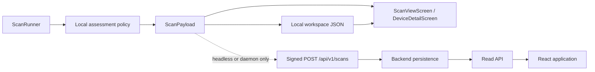

# INTEGRATION — Attack surface and IoT profiling

## Two independent read paths

The TUI has no backend connection. The agent produces one assessment-bearing `ScanPayload`, but
the local and cloud paths diverge after serialization:

`ScanProgressScreen` constructs `ScanRunner` and receives its result in process. It may open the
same payload from the local workspace later. It never calls FastAPI, never waits for upload, and
does not require backend configuration. `IngestClient` belongs to headless/daemon execution.
React is the inverse: it reads backend responses and never opens the TUI's local JSON.

PR #143 / spec 046 precedes this feature and supplies the durable machine inventory plus the
canonical `MachineType`. Spec 048 follows this feature and may add targeted observations to the
same assessment input. Spec 047 itself works in every scan mode from the evidence already produced
by the general pipeline.

## Cross-layer contract

The canonical wire source is `contracts/openapi/openapi.yaml`. Agent and backend Pydantic models
must match it exactly. Frontend aliases come only from generated
`frontend/src/types/openapi.d.ts`; application code must not hand-write API shapes.

| Concern | Agent/local JSON and ingest | Backend storage/read | TUI |
|---|---|---|---|
| Existing coarse type | Nullable legacy-compatible `hosts[].machine_type` uses PR #143's nine values | `hosts.machine_type` remains the canonical inventory field | Reads the host field from local `ScanPayload` |
| Policy marker | `assessment_policy_version: string | null`, default null | Nullable scan column plus `assessment_status` | Null means unavailable, not clean |
| Attack surface | Top-level `exposures: ExposurePayload[]`, default empty | One `ExposureRecord` per open endpoint in a scan | Reads the local list directly |
| Rich profile | Nullable `hosts[].device_profile` | Immutable scan-host snapshot plus latest host projection | Reads the local host profile directly |
| Inventory | Existing `hosts[].ports[]` unchanged | Existing scan and durable inventory views | Existing host/port views unchanged |
| Vulnerability | Existing `findings[]` unchanged | Existing finding/risk pipeline | Existing finding counts unchanged |
| Relationship | Shared `(ip, protocol, port)` | Resolved `port_id`; sorted related finding IDs on reads | Derived from the same local endpoint key |
| Legacy | Null version, empty exposures, null profiles | `assessment_status=unavailable` | Shows unavailable copy |
| Partial | Assess accepted evidence and retain version | Stored with existing partial metadata | Shows existing partial qualification |

`MachineType` remains exactly `router | computer | camera | storage | tv | phone | printer |
sensor | unknown`. Product-family and model text may be more specific, but no `DeviceClass` enum
or tenth coarse type is introduced.

## Classification ownership and PR #143 compatibility

For current assessed payloads, the agent owns the per-scan machine type, profile, and exposure interpretation.
The backend validates and persists that snapshot. PR #143's backend
`classify_machine_type(vendor, services)` remains a compatibility fallback only for an older agent
that sends no host-level `machine_type` or profile:

1. current payload with a host-level `machine_type`: inventory reconciliation copies it to
   `HostRecord.machine_type`;
2. legacy payload without `machine_type`: inventory reconciliation uses the existing PR #143
   classifier and leaves assessment status unavailable;
3. an older scan never changes the current projection; a newer legacy scan clears the current
   profile projection/version while preserving immutable historical snapshots, so stale
   enrichment is not presented as current;
4. read paths never rerun either classifier.

This split is deliberate. Agent-side assessment is required for the disconnected TUI, while the
backend fallback preserves rolling-deployment compatibility. The shared OpenAPI enum and
cross-layer fixtures prevent the two paths from inventing different public type vocabularies.

## Validation boundary

The backend validates structural and referential truth, not policy rules:

1. null policy version requires empty exposures plus null host machine types/profiles;
2. non-null policy version requires exactly one profile per host and one exposure per unique open
   endpoint;
3. each current host `machine_type` must be in the PR #143 enum;
4. exposure IP/port/protocol must match an open endpoint in the same request;
5. closed or filtered endpoints cannot have exposures;
6. fields, enum values, list counts, and string lengths must satisfy the shared contract.

Each exposure resolves to the request's `ScanHostRecord` and `PortRecord` before insertion. The
whole ingest remains one transaction, so an invalid reference leaves no partial scan. Reads remain
organization-scoped through their resolved scan or host.

## Compatibility and rollout

1. Merge PR #143 / spec 046 first.
2. Merge OpenAPI, backend schemas/models, Alembic revision `20260915_27` (down revision
   `20260912_26`), persistence/read logic,
   PR-143 reconciliation extension, and legacy tests.
3. Deploy the backend and verify an old payload still returns `202` and reads as assessment
   unavailable while retaining its PR-143 `machine_type` fallback.
4. Deploy the agent policy/contracts. Verify the same current payload renders locally without a
   backend and round-trips through ingest when run by headless/daemon execution.
5. Regenerate frontend types and deploy the React presentation. TUI delivery is part of the agent
   build and has no backend deployment dependency for local reads.

No historical backfill runs. Existing scans keep null assessment/profile columns and zero
exposure rows. Rolling back drops only the new assessment data; PR #143's inventory and findings
remain intact.

## Error mapping

| Failure | Boundary behavior |
|---|---|
| Rule cannot classify a role/type | Emit `unknown` with bounded evidence/limitation; scan continues. |
| Evidence is malformed or contradictory | Ignore unsafe value, record a bounded conflict/limitation, and lower confidence. |
| Assessment violates cardinality | Treat as normalization failure under existing contingency behavior. |
| TUI has no backend connectivity | No effect; local result remains available and no API call is attempted. |
| Headless/daemon upload fails | Existing transport behavior applies; the saved local payload is unchanged. |
| Legacy local JSON lacks fields | Defaults load; TUI shows assessment unavailable. |
| Legacy ingest lacks fields | Backend accepts it, uses PR #143 type fallback, and reports assessment unavailable. |
| Current payload omits/duplicates assessment records | Backend returns `422`; persistence does not start. |
| Database failure | Existing ingest failure behavior; transaction rolls back all scan children. |
| Exposure and finding share an endpoint | Store/display both without changing vulnerability counts. |
| Corrupt non-null stored profile | Fail through existing server-error handling; do not relabel it unavailable. |

## Integration verification

The shared fixture `contracts/examples/scan_result.example.json` contains an open endpoint with no
finding, an endpoint with both categories, a confident IoT profile, and an unknown/conflicting
profile. Agent contract tests and backend ingest tests validate the same fixture; persisted reads
feed frontend MSW fixtures.

Acceptance additionally proves:

- a TUI scan with transport unconfigured renders profiles/exposures and performs no HTTP request;
- vulnerability totals are unchanged by exposure records;
- exposure count equals unique open endpoints for current payloads;
- current host `machine_type` reaches `HostRecord.machine_type`, while a legacy payload follows
  the PR #143 fallback;
- identical evidence and policy version yield identical ordered assessment content;
- pre-feature local files and database rows show unavailable, not clean;
- no assessment test permits network, subprocess, external lookup, or secret-bearing evidence;
- migration privilege tests confirm no `anon`/`authenticated` access to `exposures`.
