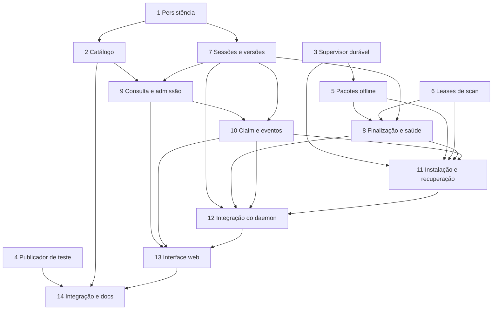

# Tasks — Atualização remota do agente (`052-remote-agent-updates`)

14 tasks. **Tasks 1–4 concluídas. Unblocked now: #5, #6, #7** (dependências de código; próxima execução aguarda comando do usuário).

## Escopo e estado

O usuário autorizou a decomposição em tarefas em 2026-10-17. A Task 1 foi iniciada por
comando explícito e concluída após testes de persistência/migração, suíte backend e revisão
independentes. A revisão técnica das propostas em `REVIEW.md` não é revisão deste ledger
nem aprovação de código; o parecer da implementação está registrado em `PROGRESS.md`.

Base desta decomposição: branch `feature/remote-agent-updates`, HEAD `a178aa6`.
As specs foram investigadas/revisadas em `b207a83`; antes de cada tarefa, conferir seus
caminhos, símbolos, chamadores e decisões contra a base efetiva. A cadeia de migrações
visível nesta base termina em `20260928_38`, não na revisão 40 citada no planejamento
original. Não executar pull, trocar branch ou alterar histórico para resolver esse drift.
Confirmar o head Alembic real antes de criar a migração proposta da Task 1.

Fonte dos caminhos: tabela de nomes e integração em `INTEGRATION.md`, referenciada por
`ARCHITECTURE.md`, e caminhos de UI em `DESIGN.md`. E = existente; N = proposto.
Arquivos compartilhados são estendidos em sequência; tarefas posteriores não substituem
a solução aprovada por uma implementação temporária. Cada tarefa entrega comportamento
e testes; o fechamento não adia a validação das tarefas anteriores.

## Modelos, papéis e gates

- Orquestrador: **GPT-6.1 Sol medium**; mantém ledger/handoffs. Arquitetura: **Sol high**
  somente quando surgir uma decisão crítica não resolvida pelas specs.
- Coder (`agent-developer`): **GPT-6 Luna medium**, uma tarefa por contexto.
- Tester independente: **GPT-6 Luna medium**. Usar `test-engineer` nas camadas Python e
  `frontend-test-engineer` no front.
- Reviewer independente: **GPT-6.1 Sol high** nas Tasks 1–12 e na integração crítica da
  Task 14; **Sol medium** na Task 13 e na revisão delimitada de UI/docs da Task 14.
  Usar `code-reviewer` para Python/pacotes e `frontend-code-reviewer` para o front.
- Docs-sync da Task 14: **GPT-6 Luna medium**, uma vez para o diff completo.
- Selecionar modelo/esforço na chamada real; não afirmar que esta sessão coordenadora
  mudou de modelo. Se indisponível, registrar antes de substituir. Não estimar economia
  ou saldo do plano sem métricas comparáveis.
- Fluxo sequencial: coder → tester → reviewer → próxima tarefa. Handoff curto com caminhos,
  decisões, resultados e bloqueios. Após rejeição, novo coder; quarta rejeição aciona
  reavaliação estrutural conforme `feature-orchestrator`.

Gates por camada, executados durante desenvolvimento autorizado:

| Camada | Verificação |
|---|---|
| Agente | Testes focais por tarefa; no fechamento, `uv run pytest` e `uv run ruff check src tests` em `hardware-agent/`, além dos hooks de black/ruff aplicáveis. Nunca formatar o repositório inteiro. |
| Linux/pacotes | Flock, subprocessos, systemd, APT/dpkg e instalação offline em Linux descartável compatível; skips do Windows não comprovam essas propriedades. Repositório e chaves exclusivamente de teste. |
| Backend | Preparar banco com `database.ps1`/`database.sh`, usar `DATABASE_URL_TEST` apontando para **dmitri_test**, depois testes focais. No fechamento, `uv run ruff check src tests` e `uv run pytest` em `backend/`; nunca `ruff format`. |
| Frontend | `npm run lint`, `npm run format:check`, `npm run typecheck`, `npm test`, `npm run build` em `frontend/`. Tipos gerados com `npm run gen:types`, nunca editados à mão. |
| Contrato | Skill `openapi-contract-sync` nas rotas implementadas, fidelity tests e regeneração dos tipos. Não publicar endpoints ou capacidades cuja implementação ainda não está pronta. |

Uma tarefa mult camada usa os pares tester/reviewer de cada camada. Gate indisponível ou
falhando é bloqueio, não aprovação. Testes não podem iniciar/cancelar scan real, usar o
Raspberry, instalar APT no host nem empregar credenciais de produção.

## Pré-requisitos externos — HUMAN_INFRA_REQUIRED

Não são tarefas automáticas de código, nem condições para inventar uma infraestrutura:

| ID | Decisão/evidência necessária | Onde bloqueia |
|---|---|---|
| H1 | Hosting HTTPS, origin/suite e responsáveis por disponibilidade/retenção; leitura validada numa appliance limpa. | Publicação real e importação operacional do catálogo. |
| H2 | Autoridade de assinatura, fingerprint aprovado, custódia/rotação/revogação, permissões de promoção e segredos protegidos. | Assinatura/promoção real; nunca usar chave privada no build. |
| H3 | Inventário da appliance: Debian/arm64/Python/uv/dependências, recursos e baseline recuperável; plataforma inicial proposta deve ser confirmada. | Bootstrap e deploy; testes compatíveis continuam isolados. |
| H4 | Responsável/acesso para bootstrap assistido e manutenção ociosa; validar Signed-By, companion, timer check-only e preservação de dados. | Habilitar capacidade de atualização num dispositivo real. |
| H5 | Responsável por canário e recuperação assistida, com evidências de falha/reinício e artefatos anteriores retidos. | Uso operacional e expansão do rollout. |
| H6 | Integração humana de `.github/workflows/agent-release.yml` e ajustes de `.github/workflows/ci.yml`, com tags/ambientes protegidos e jobs separados de build e assinatura. | Pipeline de publicação operacional; criar workflow/segredos não é efeito automático deste ledger. |

As Tasks 2–4 podem ser verificadas com catálogo/repositório e pacotes de teste. Isso não
remove H1–H6. A Task 14 distingue fechamento do código de prontidão operacional e não
declara a feature operacional se esses requisitos estiverem pendentes. Atualização do Pi,
publicação de release, scan real e commit/push dependem de autorização para a operação.

## Task 1: Persistir releases, operações e eventos com invariantes
- **Description**: Implementar modelos, schemas e migração aditiva descritos em `INTEGRATION.md` (Persistence and concurrency), preservando os modelos de scans e `Command`. Conferir a cadeia Alembic real antes de definir o parent da revisão proposta.
- **Absorbed**: Registro dos modelos, campos de versão em Agent e índices/constraints pertencem à mesma entrega porque os testes de migração e persistência verificam o conjunto.
- **Dependencies**: —
- **Target Files**: `backend/src/api/models/agent_update.py` (N), `backend/src/api/schemas/agent_updates.py` (N), `backend/src/api/models/command.py`, `backend/src/api/models/__init__.py`, `backend/src/api/schemas/agents.py`, `backend/alembic/versions/20261017_41_remote_agent_updates.py` (N; parent a conferir), `backend/tests/test_agent_updates_migration.py` (N), `backend/tests/test_agent_updates.py` (N).
- **Tests**: Migration round trip seguro, campos inicialmente nulos, constraints de fase/código, identidade imutável de release, uma operação ativa por dispositivo, idempotência e sequência única; não perder dados de scan existentes. Integração dos gates em `test_alembic_single_head.py`, `test_command_models.py`, `test_auth_wiring.py`, `test_error_envelope.py` e `test_users_routes.py`: expectativas atualizadas e fixtures PostgreSQL compartilhadas para suportar o novo metadata.
- **Success Criteria**:
  - U01/U08/U14: versões não são preenchidas a partir do checkout; auditoria retém versões, ator seguro e horários sem segredos.
  - Tabelas `agent_releases`, `agent_updates`, `agent_update_events` e `agent_release_catalog_state` correspondem ao contrato; índices suportam histórico e expiração.
  - Constraints impedem conflitos mesmo com duas transações; `needs_intervention` mantém reserva; `Command` permanece exclusivo de scans.
  - Upgrade parte do head efetivo; downgrade recusa perda de registros/reservas de update e é testado em `dmitri_test`.
- **Models**: Coder/tester Luna medium; reviewer Sol high.
- **Status**: COMPLETED
- **Review Rejections**: 2

## Task 2: Importar e projetar o catálogo de releases verificadas
- **Description**: Implementar a cadeia de confiança e disponibilidade em `ARCHITECTURE.md` (Release identity and trust) e `INTEGRATION.md`. Importação periódica usa somente o repositório configurado e persiste evidências verificadas.
- **Absorbed**: Configuração pública de repositório/keyring e registro do worker são testados junto ao importador, sem tarefa separada de constantes.
- **Dependencies**: Task 1
- **Target Files**: `backend/src/api/services/release_catalog.py` (N), `backend/src/api/models/agent_update.py`, `backend/src/api/core/config.py`, `backend/src/api/services/worker.py`, `backend/tests/test_release_catalog.py` (N).
- **Tests**: Repositório local com chave descartável: assinatura inválida, expiração, hash/size divergentes, catálogo anterior reapresentado, colisão de identidade, retirada de release e falha de refresh sem apagar evidência anterior.
- **Success Criteria**:
  - U02/U09/U16: validar InRelease ou Release/Release.gpg → catálogo e Packages → identidade/hash do pacote; TLS não substitui assinatura.
  - Gerar disponibilidade apenas para plataforma/protocolo/updater compatíveis; usar comparação Debian, incluindo `1.0.10 > 1.0.9`.
  - Catálogo ausente/inválido/expirado é indisponível, versão instalada desconhecida é desconhecida; não apresentar ambos como atualizado.
  - Persistir geração monotônica, digest e validade; rejeitar replay/catálogo conflitante. Leitura HTTP futura não dispara refresh ou instalação.
- **Models**: Coder/tester Luna medium; reviewer Sol high.
- **Status**: COMPLETED
- **Review Rejections**: 2

## Task 3: Criar supervisor durável e política manual de atualização
- **Description**: Implementar a base do companion conforme `ARCHITECTURE.md` (Permanent updater e process lifetime): socket local restrito, journal, gate de mutação, supervisão e timer somente de consulta. Não habilitar instalação antes da Task 11.
- **Absorbed**: Serviço, helper e timer integram o comportamento de início/recuperação testado; não são tarefas isoladas de configuração.
- **Dependencies**: —
- **Target Files**: `hardware-agent/packaging/updater.py` (N), `hardware-agent/packaging/apt-upgrade-agent`, `hardware-agent/packaging/dmitri-agent-update.service`, `hardware-agent/packaging/dmitri-agent-update.timer`, `hardware-agent/packaging/dmitri-agent-update-check.service` (N), `hardware-agent/dmitri-agent.service`, `hardware-agent/tests/unit/test_updater.py` (N), `hardware-agent/tests/unit/test_update_scripts.py`.
- **Tests**: Reiniciar supervisor com journal/gate pendentes; chamadas locais não autorizadas, mensagens malformadas, estado corrompido, duas transações simultâneas, check durante operação e teardown de filhos.
- **Success Criteria**:
  - U06/U08/U12: socket root-only com verificação do peer e mensagens fechadas; nenhuma execução de shell/argv arbitrário ou parsing de env como shell.
  - Journal SQLite durável, estado/gate gravados antes de efeitos; corrupção bloqueia mutação e conserva evidências.
  - `Type=notify` restabelece o gate antes de liberar startup; saúde do agente não cria deadlock de ordem entre units. Cgroup encerra filhos antes de recuperação.
  - Timer/default helper apenas verificam metadados; nunca instalam ou reiniciam agente. Mutex cobre consulta e preflight; não apagar locks APT/dpkg.
  - Sem endpoint de instalação incompleto anunciado; a base oferece somente suas capacidades implementadas até Task 11.
- **Models**: Coder/tester Luna medium; reviewer Sol high.
- **Status**: COMPLETED
- **Review Rejections**: 1

## Task 4: Preparar publicação imutável e verificável em repositório de teste
- **Description**: Implementar o publicador de artefatos em `ARCHITECTURE.md` (Release identity and trust). Separar código testável de publicação, assinatura e proteção de CI dependentes de H1/H2/H6.
- **Dependencies**: —
- **Target Files**: `hardware-agent/packaging/publish-apt.sh` (N), `hardware-agent/tests/unit/test_update_scripts.py`.
- **Tests**: Publicar pacotes artificiais num diretório descartável; verificar metadados/catálogo assinados com chave de teste, recusa de colisão, falha durante promoção atômica, refresh de validade e retenção de release anterior.
- **Success Criteria**:
  - U02/U09/U16: release liga UUID, commit, versões, plataforma, hash/size, requisitos e notas; pacote publicado não é sobrescrito por bytes diferentes.
  - Snapshot expõe índices por conteúdo e promove metadados atomicamente; falha não deixa catálogo apontando para pacote ausente.
  - Não remover artefatos referenciados por frota/operação/recuperação; refresh de metadados não altera bytes do pacote.
  - Build não exige chave de produção; assinatura é uma etapa separada. Nenhuma publicação externa, chave ou workflow de CI é criado por esta tarefa.
- **Models**: Coder/tester Luna medium; reviewer Sol high.
- **Status**: COMPLETED
- **Review Rejections**: 0

## Task 5: Construir pacotes offline do agente e do companion
- **Description**: Adaptar builder e preparação assistida conforme `ARCHITECTURE.md` (Permanent updater e Installation and recovery). Produzir agente arm64 com wheelhouse e companion independente, verificáveis sem instalação no host ou Pi.
- **Absorbed**: Versão independente do companion, requisitos/lockfile, transferência de ownership e bootstrap pertencem aos testes de pacote; nenhuma tarefa isolada para version/config.
- **Dependencies**: Task 3
- **Target Files**: `hardware-agent/packaging/build-deb.sh`, `hardware-agent/packaging/updater-version` (N), `hardware-agent/pyproject.toml`, `hardware-agent/uv.lock`, `hardware-agent/scripts/check_agent_version.py`, `hardware-agent/scripts/provision-pi.sh`, `hardware-agent/packaging/scan-lock-path`, `hardware-agent/tests/unit/test_update_scripts.py`, `hardware-agent/tests/integration/test_update_recovery.py` (N).
- **Tests**: Inspecionar .deb e hooks; construir e instalar fixtures em Linux descartável compatível sem rede; dependências ausentes e payload incorreto recusados; preservar identidade/resultados na migração de ownership.
- **Success Criteria**:
  - U09/U11/U16: mapear versões numéricas upstream para Debian `-1`, recusar reconstrução diferente da mesma identidade e validar avanço de versão.
  - Agente contém wheel, wheelhouse e requisitos com hashes derivados do lock; instalação usa Python/uv já preparados e não baixa dependências nem Python.
  - Companion possui helper, lock-path e units conforme transferência `Breaks/Replaces`; empacota a assinatura existente fora da árvore substituída e usa Python do sistema.
  - Postinst do agente não inicia serviço nem instalação automática; bootstrap exige ociosidade, preserva dados e prepara baseline recuperável. Não anunciar capacidade antes de todo o runtime das Tasks 3/8/11/12 existir.
  - Evidência de empacotamento é isolada; não executar provisionamento real e não alterar CI nesta tarefa (H3/H4/H6).
- **Models**: Coder/tester Luna medium; reviewer Sol high.
- **Status**: PENDING
- **Review Rejections**: 0

## Task 6: Proteger todos os caminhos de scan e a vida dos subprocessos
- **Description**: Implementar lease compartilhado, gate e validação de versão em `ARCHITECTURE.md` (Admission, exclusion and process lifetime). Cobrir CLI, headless, daemon, runner isolado e TUI, incluindo persistência de resultados e filhos.
- **Dependencies**: —
- **Target Files**: `hardware-agent/src/agent/scanner/scan_lock.py`, `hardware-agent/src/agent/scanner/runner.py`, `hardware-agent/src/agent/headless.py`, `hardware-agent/src/agent/daemon.py`, `hardware-agent/src/agent/cli.py`, `hardware-agent/src/agent/tui/screens/home.py`, `hardware-agent/src/agent/tui/screens/scan_progress.py`, `hardware-agent/src/agent/scanner/nmap.py`, `hardware-agent/src/agent/targeted/executor.py`, `hardware-agent/src/agent/targeted/stage.py`, `hardware-agent/tests/unit/test_scan_lock.py`, `hardware-agent/tests/unit/test_headless.py`, `hardware-agent/tests/unit/test_daemon.py`, `hardware-agent/tests/unit/test_scan_progress_screen.py`, `hardware-agent/tests/integration/test_tui_flows.py`.
- **Tests**: Flock real em Linux, corrida scan/update, criança sobrevivente ao pai, mesmo inode, lease emprestado sem deadlock, falha de escrita, gate persistente sem PID e TUI antiga após troca de versão.
- **Success Criteria**:
  - U05/U06/U12: scan retém lease até persistência/entrega/finalização aplicável; atualização exclusiva é recusada enquanto esse trabalho existe e o inverso também ocorre.
  - Passar lease explicitamente por HomeScreen → ScanProgressScreen → ScanRunner e CLI/daemon → headless → ScanRunner; manter semântica compartilhada entre scans locais.
  - NmapRunner/LoggedNmapRunner, runner injetado, executor fornecido e fallback de targeted recebem FD; join de filhos precede liberação. Não substituir inode do lock.
  - Scan adquire lease e verifica gate/identidade da instalação; processo TUI obsoleto deve reiniciar antes de novo scan. Source checkout conserva seu comportamento fora do suporte de atualização appliance.
  - Conferir todos os construtores/chamadores por busca; nenhum scan real é executado pelos testes.
- **Models**: Coder/tester Luna medium; reviewer Sol high.
- **Status**: PENDING
- **Review Rejections**: 0

## Task 7: Persistir versões e negociar sessões compatíveis no backend
- **Description**: Implementar registry guard, hello negociado, schemas de frames e confirmação terminal de scan conforme `INTEGRATION.md` (WS contract). Clientes legados mantêm o contrato existente.
- **Absorbed**: Projeção de versão, endpoint assinado de probe e atualização dos contratos de frames pertencem aos testes de conexão e read routes; não há tarefa isolada de wrappers.
- **Dependencies**: Task 1
- **Target Files**: `backend/src/api/services/agent_connections.py`, `backend/src/api/services/agent_ws.py`, `backend/src/api/schemas/agent_frames.py`, `backend/src/api/services/agents.py`, `backend/src/api/services/commands.py`, `backend/src/api/routers/agents.py`, `backend/src/api/routers/agent_updates.py` (N, inicialmente só probe), `backend/src/api/main.py`, `backend/src/api/dependencies/agent_auth.py`, `backend/src/api/schemas/agents.py`, `backend/src/api/schemas/agent_updates.py`, `contracts/openapi/openapi.yaml`, `frontend/src/types/openapi.d.ts`, `backend/tests/test_agent_ws_channel.py`, `backend/tests/test_agent_connections.py`, `backend/tests/test_agent_frames.py`, `backend/tests/test_agent_read_routes.py`, `backend/tests/test_contract_fidelity.py`.
- **Tests**: Hello legado/estendido, substituição e desconexão de socket, persistência de versão offline, sessão velha emitindo frames, commit falhando antes do ACK e status terminal duplicado.
- **Success Criteria**:
  - U01/U07/U08/U10: guard por dispositivo serializa sessão/hello; ordem guard → Agent row; trabalho de DB permanece fora do event loop.
  - Hello aceito persiste versão/data somente da sessão atual; desconexão remove capacidade atual sem apagar versão histórica.
  - Enviar `update_session` e `scan_status_ack` somente à capacidade negociada; ACK de scan somente após commit de status terminal pertencente ao dispositivo, incluindo repetição idêntica.
  - Frames de socket substituído não alteram estado nem produzem ACK; schemas rejeitam campos extras. Não entregar frame de update nesta tarefa.
  - Expor GET assinado `update-protocol` para o próprio dispositivo, apenas com versões suportadas; leitura sem efeito colateral. Isso permite o probe da Task 8 antes da API de admissão da Task 9.
  - Contrato de scans/ingest e clientes antigos permanecem cobertos; tipos gerados refletem apenas mudanças implementadas.
- **Models**: Coder/tester Luna medium; reviewer Sol high.
- **Status**: PENDING
- **Review Rejections**: 0

## Task 8: Recuperar finalização de scan e provar saúde local do agente
- **Description**: Implementar checkpoint durável e replay de upload/status, probe de protocolo e saúde local conforme `ARCHITECTURE.md` e `INTEGRATION.md`. Reconciliação retoma finalização salva; não reexecuta a varredura.
- **Absorbed**: CLI fixa `dmitri health --json` e handshake de readiness são a evidência observável para o supervisor e pertencem aos testes de startup/saúde desta tarefa.
- **Dependencies**: Tasks 5, 6, 7
- **Target Files**: `hardware-agent/src/agent/daemon.py`, `hardware-agent/src/agent/transport/command_channel.py`, `hardware-agent/src/agent/transport/ingest.py`, `hardware-agent/src/agent/headless.py`, `hardware-agent/src/agent/cli.py`, `hardware-agent/packaging/updater.py`, `hardware-agent/tests/unit/test_daemon.py`, `hardware-agent/tests/unit/test_command_channel.py`, `hardware-agent/tests/unit/test_headless.py`, `hardware-agent/tests/unit/test_cli_agent.py`, `hardware-agent/tests/unit/test_updater.py` (N).
- **Tests**: Reinício em cada fase do scan remoto, perda de ACK, ingest fechado, falha de escrita, backend antigo recusando campos extras e readiness de PID/invocation/nonce antigo.
- **Success Criteria**:
  - U05/U07/U08/U12: gravar comando antes de executar e referência ao resultado antes de upload; checkpoint só é liberado pelo ACK terminal correspondente da sessão atual.
  - Reinício reenvia artefato/status salvos; scan interrompido sem resultado é reportado como falha, sem novo Nmap. Ingest definitivamente fechado conserva o artefato e reconcilia status.
  - Supervisor recusa claim com checkpoint pendente mesmo sem flock ativo. Lease e estado durável não deixam janela entre escrita, upload e confirmação.
  - Probe usa contrato implementado quando disponível; 404/sem suporte envia hello legado. Capacidade de instalação só será anunciada na Task 12.
  - Saúde fixa verifica imports/versão/configuração/acesso a resultados sem scan ou segredos; handshake local associa MainPID/invocation/versões ao desafio atual, sem depender do backend e sem adquirir lease de scan.
- **Models**: Coder/tester Luna medium; reviewer Sol high.
- **Status**: PENDING
- **Review Rejections**: 0

## Task 9: Expor consulta e admissão manual de atualizações
- **Description**: Implementar consultas e solicitação manual em `INTEGRATION.md` (HTTP contract), preservando o probe entregue na Task 7, com reserva entre scans e updates e uma única entrega na sessão capturada. O backend suporta o protocolo antes de o agente anunciar prontidão na Task 12.
- **Absorbed**: Registro de router, erros fechados, expiração de pedidos e publicação de contrato são testados junto às rotas; não criar tarefa de schema/API sem consumidor.
- **Dependencies**: Tasks 1, 2, 7
- **Target Files**: `backend/src/api/services/agent_updates.py` (N), `backend/src/api/routers/agent_updates.py`, `backend/src/api/schemas/agent_updates.py`, `backend/src/api/services/commands.py`, `backend/src/api/services/agents.py`, `backend/src/api/services/agent_connections.py`, `backend/src/api/main.py`, `backend/src/api/errors.py`, `backend/src/api/services/worker.py`, `backend/src/api/dependencies/auth.py`, `backend/src/api/dependencies/agent_auth.py`, `contracts/openapi/openapi.yaml`, `frontend/src/types/openapi.d.ts`, `backend/tests/test_agent_updates.py` (N), `backend/tests/test_enqueue_command.py`, `backend/tests/test_agent_read_routes.py`, `backend/tests/test_contract_fidelity.py`.
- **Tests**: Admin/viewer/outra organização e role revogado no momento da transação; duas solicitações simultâneas, corrida com scan, idempotência, indisponibilidade de catálogo, dispositivo offline/legado/revogado e envio perdido.
- **Success Criteria**:
  - U02–U08/U14: GETs de disponibilidade/histórico/operação são somente leitura; probe assinado informa suporte, sem alterar dispositivo.
  - Criação requer UUID Idempotency-Key, corpo fechado e versão esperada; mesmo key/body retorna operação sem reenvio, corpo diferente conflita; conferir role viva na transação.
  - Admissão de scan e update usa a mesma Agent row e reserva persistida; proibir update enquanto scan/upload/finalização estão ativos e scan durante reserva de update.
  - Commit de intenção precede envio único na sessão corrente capturada; não reenviar após substituição, não enfileirar offline e não criar scan fictício. Só pedidos não reclamados expiram no worker.
  - Rotas implementadas, envelope de erros e OpenAPI/tipos gerados permanecem fiéis; probe não significa que agente antigo pode se atualizar.
- **Models**: Coder/tester Luna medium; reviewer Sol high.
- **Status**: PENDING
- **Review Rejections**: 0

## Task 10: Validar claim, eventos e confirmação observada no backend
- **Description**: Implementar endpoints assinados de claim/eventos e reconciliação conforme `INTEGRATION.md` (State, deadlines e Persistence). Separar resultado local, contato e confirmação remota.
- **Dependencies**: Tasks 7, 9
- **Target Files**: `backend/src/api/services/agent_updates.py`, `backend/src/api/routers/agent_updates.py`, `backend/src/api/schemas/agent_updates.py`, `backend/src/api/services/agent_ws.py`, `backend/src/api/dependencies/agent_auth.py`, `backend/src/api/services/device_sig.py`, `backend/src/api/errors.py`, `contracts/openapi/openapi.yaml`, `frontend/src/types/openapi.d.ts`, `backend/tests/test_agent_updates.py`, `backend/tests/test_agent_ws_channel.py`, `backend/tests/test_contract_fidelity.py`.
- **Tests**: Claim expirado, sessão substituída, dono incorreto, recibo duplicado sem prazo estendido, nonce repetido, eventos fora de ordem/conflitantes, hello/evento em ordens opostas, perda de rede e revogação durante operação.
- **Success Criteria**:
  - U03/U08–U14: claim vincula dispositivo/operação/sessão/release/digest e grava autorização limitada antes de resposta; duplicação devolve o mesmo recibo.
  - Assinatura/nonce validam caminho e proprietário; sequência seguinte é obrigatória, duplicata idêntica é reconhecida e conteúdo divergente conflita.
  - Rejeitar transições ilegais, regressão terminal e evidência de instalação sem claim; conservar auditoria sem blobs/logs/config sensíveis.
  - `succeeded` exige evento durável de saúde local e hello atual correspondente à operação/invocation/versão em qualquer ordem; hello isolado não prova instalação saudável.
  - Rede/backend indisponível não vira falha local nem rollback; `needs_intervention` conserva reserva, revogação bloqueia admissão/reporte remoto sem cancelar recuperação local.
- **Models**: Coder/tester Luna medium; reviewer Sol high.
- **Status**: PENDING
- **Review Rejections**: 0

## Task 11: Instalar, verificar e recuperar pelo supervisor independente
- **Description**: Completar o companion com preflight, claim, instalação offline, verificação local, recuperação e reporter durável em `ARCHITECTURE.md` (Installation and recovery). Usar o protocolo real das Tasks 9/10, com clientes falsos somente em testes.
- **Absorbed**: Reporter HTTP assinado, retenção de cache/snapshot e deadlines integram a máquina de estados durável, cuja validade depende desses comportamentos.
- **Dependencies**: Tasks 3, 5, 6, 8, 10
- **Target Files**: `hardware-agent/packaging/updater.py`, `hardware-agent/packaging/apt-upgrade-agent`, `hardware-agent/packaging/build-deb.sh`, `hardware-agent/src/agent/transport/signing.py`, `hardware-agent/tests/unit/test_updater.py`, `hardware-agent/tests/integration/test_update_recovery.py`.
- **Tests**: APT/dpkg/uv/systemd/HTTP controlados e fixtures Linux; pacote/hash/plataforma incompatível, pacote anterior ausente, lock/recursos insuficientes, postinst/uv/OOM/saúde falhando, perda de energia simulada em cada fronteira e agente/venv inacessível.
- **Success Criteria**:
  - U05/U06/U08–U14: verificar confiança APT, versão/plataforma/updater, espaço/inodes e estado dpkg; simulação recusa remoções e alterações fora de hardware-agent.
  - Sob exclusão mútua, journal/claim/recibo/gate duráveis precedem mutação; cache e rehash de alvo e anterior são obrigatórios. Deadlines impedem mutação tardia e não matam dpkg cegamente.
  - Parar agente/cgroup, salvar árvore/venv e instalar versão/digest exatos sem rede; FD exclusivo não chega a dpkg/postinst/agente reiniciado.
  - Saúde exige dpkg configurado, CLI fixa e handshake do processo esperado; ausência de backend mantém confirmação pendente e não provoca recuperação.
  - Falha após mutação tenta uma recuperação offline controlada do pacote/árvore/venv anterior; falha de recuperação conserva gate/evidências e resulta em `needs_intervention`, sem loop de repair geral.
  - Reporter independente usa assinatura existente, nova nonce a cada retry, sequência/ack persistidos e backoff; sobrevive à troca/falha do agente e pausa em 403 sem perder resultado. Não apagar identidade, configuração ou resultados ao limpar cache.
- **Models**: Coder/tester Luna medium; reviewer Sol high; decisão arquitetural nova exige Sol high antes de ampliar escopo.
- **Status**: PENDING
- **Review Rejections**: 0

## Task 12: Conectar o daemon ao atualizador e habilitar capacidade real
- **Description**: Fechar entrega WS → daemon → socket companion e o hello de reconciliação em `INTEGRATION.md`. Anunciar `agent_update_v1` apenas com suporte negociado, instalação preparada e supervisor pronto.
- **Dependencies**: Tasks 7, 8, 10, 11
- **Target Files**: `hardware-agent/src/agent/transport/command_channel.py`, `hardware-agent/src/agent/daemon.py`, `hardware-agent/packaging/updater.py`, `hardware-agent/tests/unit/test_command_channel.py`, `hardware-agent/tests/unit/test_daemon.py`, `hardware-agent/tests/unit/test_updater.py`.
- **Tests**: Frame completo/malformado, sessão antiga, expiração, entrega duplicada, supervisor ausente/incompatível, checkpoint pendente, reconexão durante instalação e hello com contexto de recuperação.
- **Success Criteria**:
  - U07/U08/U10/U12/U13/U16: probe por conexão e supervisor pronto governam capability; ausência exige bootstrap, independentemente de número de versão.
  - Dispatcher aceita apenas IDs/versões/hash/prazo do frame fechado; encaminha ao companion sem shell, URL ou campos de scan.
  - Repetição/reconexão não recria intenção nem reexecuta install; sessão nova pode reconciliar operação reclamada, nunca executar pedido antigo não reclamado.
  - Hello incorpora contexto observado pelo supervisor para operação/invocation/versão; o daemon substituído não é dono exclusivo da conclusão.
  - Entrega de update não chama start/cancel de scan; não anunciar capacidade se checkpoint/estado local impedir a operação.
- **Models**: Coder/tester Luna medium; reviewer Sol high.
- **Status**: PENDING
- **Review Rejections**: 0

## Task 13: Oferecer atualização manual e histórico na página do dispositivo
- **Description**: Implementar a seção de atualização conforme `DESIGN.md` e os tipos gerados do contrato estabilizado. Mostrar disponibilidade, versões, confirmação, andamento e histórico usando componentes existentes.
- **Absorbed**: Cliente tipado, query keys/hook, mocks e traduções são exercitados pelo fluxo da página; não ganham ciclos isolados de coder/tester/reviewer.
- **Dependencies**: Tasks 9, 10, 12
- **Target Files**: `frontend/src/pages/DeviceDetail.tsx`, `frontend/src/pages/agents/AgentUpdateSection.tsx` (N), `frontend/src/api/agentUpdates.ts` (N), `frontend/src/hooks/useAgentUpdate.ts` (N), `frontend/src/api/agents.ts`, `frontend/src/api/queryKeys.ts`, `frontend/src/hooks/useToast.ts`, `frontend/src/pages/agents/ScanControl.tsx`, `frontend/src/hooks/useScanCommand.ts`, `frontend/src/i18n/messages/en.ts`, `frontend/src/i18n/messages/pt-BR.ts`, `frontend/src/i18n/messages/ru.ts`, `frontend/src/i18n/messages/catalog.types.ts`, `frontend/src/test/agentsHarness.ts`, `frontend/src/pages/DeviceDetail.updates.test.tsx` (N), `frontend/src/pages/DeviceDetail.test.tsx`, `frontend/src/pages/DeviceDetail.command.test.tsx`.
- **Tests**: Matriz de disponibilidade/readiness/fases; Viewer e dispositivo revogado; confirmação e idempotência; erro de rede; sucesso local pendente versus confirmado; rollback/intervenção; pt-BR/en/ru, teclado/foco/live region e preservação dos controles de scan.
- **Success Criteria**:
  - U01–U05/U07/U10/U11/U14/U15: seção após identidade e antes dos controles/histórico de scan, visível também nos estados somente leitura.
  - Admin confirma dispositivo/versão; Viewer não tem ação de mutação; offline/legado/revogado/busy não oferece instalação ou fila futura.
  - Mostrar versões observadas e datas sem inventar valores; diferenciar aceite, instalação, saúde local, contato e confirmação remota, sem percentual fabricado.
  - Polling/refetch GET são somente leitura; invalidar dispositivo/disponibilidade/histórico após mutação. Double click/retry usa idempotência e não cria update duplicado.
  - Erros usam toasts localizados; fatos persistidos continuam no histórico. Dialog/foco/aria-live funcionam e layout estreito não esconde estado.
  - Todos os textos próprios da feature têm pt-BR/en/ru; usar tokens/componentes existentes e tipos gerados. Atualizar jamais chama scan start/cancel; reserva de update impede ação remota incompatível.
- **Models**: Coder Luna medium; frontend-test-engineer Luna medium; frontend-code-reviewer Sol medium. Alteração de contrato/segurança retorna ao reviewer Sol high responsável.
- **Status**: PENDING
- **Review Rejections**: 0

## Task 14: Fechar integração, falhas e documentação verificável
- **Description**: Exercitar os contratos completos em ambiente descartável e fechar os gates de `PLAN.md`, sem rollout implícito. Sincronizar documentação uma vez após aprovação das tarefas de produto, com fatos demonstrados e bloqueios operacionais separados.
- **Absorbed**: Gates completos, ADR/code-map e guias são fechamento da matriz integrada de falhas; não criar tarefas de documentação ou comandos sem comportamento próprio.
- **Dependencies**: Tasks 2, 3, 4, 5, 6, 7, 8, 9, 10, 11, 12, 13
- **Target Files**: `hardware-agent/tests/integration/test_update_recovery.py`, `hardware-agent/tests/unit/test_update_scripts.py`, `hardware-agent/tests/unit/test_scan_lock.py`, `hardware-agent/tests/unit/test_daemon.py`, `backend/tests/test_agent_updates.py`, `backend/tests/test_release_catalog.py`, `backend/tests/test_agent_updates_migration.py`, `backend/tests/test_agent_ws_channel.py`, `backend/tests/test_enqueue_command.py`, `backend/tests/test_contract_fidelity.py`, `frontend/src/pages/DeviceDetail.updates.test.tsx`, `frontend/src/pages/DeviceDetail.command.test.tsx`.
- **Documentation**: Docs-sync conforme `ARCHITECTURE.md`/`INTEGRATION.md`: `docs/adr/ADR-021-pi-agent-updates.md`, `docs/adr/ADR-011-pi-command-channel.md`, `docs/PI-INSTALLER.md`, `docs/PI-RECOVERY.md`, `docs/DEV-SETUP.md` e entradas afetadas em `.claude/docs/`; manter `PROGRESS.md`/`USAGE.md` desta spec. Não reescrever documentação sem relação com o diff.
- **Tests**: Fluxos completos UI/API → WS → companion → pacote/saúde → eventos/hello, usando pacotes e dispositivos de teste. Cobrir corrida com scans locais/remotos, sessão substituída, backend indisponível, journal interrompido e recuperação do ambiente quebrado.
- **Success Criteria**:
  - U01–U16 têm evidência rastreável na matriz abaixo; executar gates completos por camada e integração Linux compatível, sem tratar mocks/skips como prova de instalação real.
  - Testar replay após crash/ACK perdido, evento antes/depois do hello, scan finalizando enquanto há pedido de update e supervisor reportando com árvore/venv do agente quebrada.
  - Verificar integração do catálogo/publicador com confiança, retenção e recusa de rollback de catálogo; pacote anterior permanece disponível para recuperação.
  - Atualizar ADRs para política manual/check-only, cadeia APT, companion, exclusão mútua e saúde local/remota; guias distinguem preparação, uso e intervenção.
  - Registrar resultados reais, limitações e H1–H6 atendidos/pendentes. Não publicar, instalar no Pi, executar scan real, fazer commit/push ou declarar rollout concluído como parte desta tarefa.
- **Models**: Coder/testers Luna medium por camada; reviewers Sol high para integração/segurança e Sol medium para UI/docs; docs-sync Luna medium uma vez.
- **Status**: PENDING
- **Review Rejections**: 0

## Cobertura dos critérios de TRUTH.md

| Critério | Tasks responsáveis |
|---|---|
| U01 — versão e procedência | 1, 7, 13, 14 |
| U02 — publicação disponível | 2, 4, 9, 13, 14 |
| U03 — permissões | 9, 10, 13, 14 |
| U04 — confirmação manual | 9, 13, 14 |
| U05 — scan/upload/finalização em andamento | 6, 8, 9, 11, 13, 14 |
| U06 — corrida local/remota | 3, 6, 9, 11, 14 |
| U07 — offline ou legado | 7, 8, 9, 12, 13, 14 |
| U08 — repetição e reconexão | 1, 3, 7, 8, 9, 10, 11, 12, 14 |
| U09 — publicação inválida | 2, 4, 5, 10, 11, 14 |
| U10 — reinício previsto | 7, 10, 11, 12, 13, 14 |
| U11 — falha e recuperação | 5, 10, 11, 13, 14 |
| U12 — rede ou energia interrompida | 3, 6, 8, 10, 11, 12, 14 |
| U13 — backend indisponível | 10, 11, 12, 14 |
| U14 — histórico e privacidade | 1, 9, 10, 11, 13, 14 |
| U15 — experiência localizada/acessível | 13, 14 |
| U16 — preparação/distribuição | 2, 4, 5, 12, 14 + H1–H6 |

## Dependency graph

O grafo mostra as dependências transitivas para leitura; a lista `Dependencies` de cada
tarefa é a autoridade para execução. Trilhas iniciais: persistência/backend (#1),
supervisor (#3), publicador (#4) e lease de scan (#6). Elas são independentes no grafo;
o orçamento mantém um coder por vez. Ordem serial sugerida: **1 → 2 → 3 → 4 → 5 → 6 →
7 → 8 → 9 → 10 → 11 → 12 → 13 → 14**. Depois da Task 9, completar Task 10 antes de
habilitar clientes capazes; nenhuma release intermediária incompleta é promovida.

## Status

| # | Task | Dependências | Reviewer | Status |
|---|---|---|---|---|
| 1 | Persistência e migração | — | Sol high | COMPLETED |
| 2 | Catálogo verificado | 1 | Sol high | COMPLETED |
| 3 | Supervisor durável/manual | — | Sol high | COMPLETED |
| 4 | Publicador de teste | — | Sol high | COMPLETED |
| 5 | Pacotes offline e baseline | 3 | Sol high | PENDING |
| 6 | Leases em todos os scans | — | Sol high | PENDING |
| 7 | Sessões, versões e ACK | 1 | Sol high | PENDING |
| 8 | Finalização durável e saúde | 5, 6, 7 | Sol high | PENDING |
| 9 | Consulta e admissão HTTP | 1, 2, 7 | Sol high | PENDING |
| 10 | Claim, eventos e confirmação | 7, 9 | Sol high | PENDING |
| 11 | Instalação, recuperação e reporte | 3, 5, 6, 8, 10 | Sol high | PENDING |
| 12 | Integração/capacidade no daemon | 7, 8, 10, 11 | Sol high | PENDING |
| 13 | Interface web localizada | 9, 10, 12 | Sol medium | PENDING |
| 14 | Integração, gates e docs | 2–13 | Sol high + medium por camada | PENDING |
